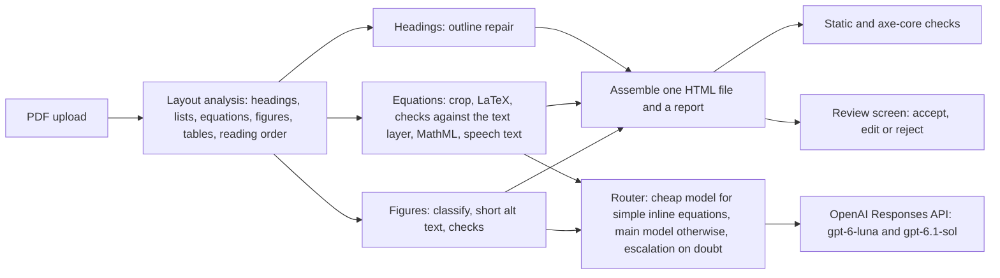

# ReadableSTEM

[](https://github.com/harishm17/a11y-stem/actions/workflows/ci.yml)
[](LICENSE)

ReadableSTEM assists instructors who need to turn a STEM course PDF into an accessible web
page. It reads the PDF, rebuilds equations as MathML a screen reader can speak, restores
headings and lists, writes short alt text for figures, and returns one self-contained HTML
file. Every change it is unsure about goes to a review screen where the instructor accepts,
edits or rejects it.

It assists; it does not certify. Nothing here establishes conformance with WCAG, the ADA or
any other standard, and the output still needs a person to look at it. That is what the
review screen is for.

ReadableSTEM was called a11y-stem until October 2026; the `a11y-stem` command still works.
The site is at readablestem.com.

**What it is not.** It is not a compliance checker. It is not an OCR engine for scans or
handwriting (those pages are kept as images and flagged). It is not a general PDF-to-Markdown
converter, and it does not work from Word, LaTeX or PowerPoint sources: it starts from the
PDF.

**Status.** Pre-release. The code, the evaluation harness and the documentation are here; a
hosted, allowlisted beta is planned for 9 November 2026.
`uv run readablestem ops launch-check` lists the launch blockers that are still open.

## See it

A converted page is committed so you can judge the output without running anything: open
[`src/readablestem/web/static/demo/index.html`](src/readablestem/web/static/demo/index.html) in a
browser. It is OpenStax *Physics* section 2.3, converted with the real models; the PDF it
came from sits beside it. The page shows the pipeline's proposals as they came, including a
mistake that the review screen asks about (a plain *v* where the book has a bold vector).

## Results

There are two kinds of number here, and they must not be mixed. The first kind is measured
on documents the system had never been run on, with the protocol written down before the
run. The second kind comes from the sample on which the checks were developed.

### Held-out results (2026-10-14)

Fifteen sections of five OpenStax books (242 Letter pages, 1,369 equations, 509 headings,
69 figures with an OpenStax alt text), chosen by a rule and registered before any system ran.
The full report, with every table, interval and per-section number, is [PROOF.md](PROOF.md);
it is replayed from the recorded model answers committed in
[`proof/bundles/heldout-2026-10/`](proof/bundles/heldout-2026-10/) (`git checkout proof-heldout-2026-10 && make proof`, no key, no
network, the same bytes every time). Intervals are 95% cluster bootstraps over the 15 sections,
which are approximate with this few and tend to be a little narrow.

**What was run, and how it differs from the registration.** The OpenAI account ran out of
credit during the first attempt (Addendum 3), and every model call of this run went to Claude
instead ([Addendum 6](proof/PREREGISTRATION-ADDENDUM-6.md), written before any model saw a
held-out section; [Addendum 7](proof/PREREGISTRATION-ADDENDUM-7.md) records what happened
during the run). ReadableSTEM ran with `claude-haiku-5-5` (cheap) and `claude-opus-5-5` (main), the
production settings otherwise, and no second automated check (that is OpenAI's). The chatbot
recipe is Purdue's one-sentence prompt, verbatim, on `claude-opus-5-5` (two runs) and on
`claude-haiku-5-5` (two runs); the registration's expert-prompt arm was not run. Figures are
judged by `claude-opus-5-5`. The open parsers are the ones recorded earlier, with no model
(Docling in its default settings, MinerU at its basic tier, PyMuPDF4LLM; the registered Docling
arm with formula recognition was not carried out). The configuration was chosen on the
development sample and frozen before the run. Nothing was tuned on these sections.

Recorded model spend: ReadableSTEM $10.88 (its figure judge included), the opus chatbot arm
$22.34 and its judge $0.72, the haiku arm $1.49 and its judge $0.78: $36.21, under the $45
ceiling. About $1.3 more went to an interrupted run that was made again, and $1.08 to the
development-sample checks that priced the run (Addendum 7).

**Where ReadableSTEM loses, and where it does not.**

| Held-out, 15 sections | ReadableSTEM | Chatbot, Opus | Chatbot, Haiku | Docling | MinerU (basic) | PyMuPDF4LLM |
|---|---|---|---|---|---|---|
| Equations right, end to end (document task) | 0.504 [0.376, 0.599] | **0.622** [0.464, 0.727] | 0.600 [0.437, 0.708] | 0 | 0.174 [0.108, 0.218] | 0 |
| Wrong equations nobody is asked about, per 100 | 23.3 [19.0, 29.5] | 24.0 [16.1, 33.4] | 25.2 [18.2, 34.6] | 0 (writes none) | 27.6 [22.2, 34.7] | 0 (writes none) |
| Heading F1 | **0.961** [0.947, 0.977] | 0.932 [0.891, 0.958] | 0.914 [0.872, 0.945] | 0.910 [0.842, 0.958] | 0.923 [0.894, 0.955] | 0.830 [0.738, 0.919] |
| Heading level right (among matched) | **1.000** | 0.341 | 0.508 | 0.031 | 0.165 | 1.000 |
| Figure descriptions the judge passes (69 figures, two runs) | **0.971** [0.933, 1.000] | 0.804 [0.680, 0.905] | 0.833 [0.742, 0.907] | none written | none written | none written |
| Figure descriptions the judge finds a factual error in | 0 of 138 | 3 of 134 | 12 of 133 | | | |
| Cost per PDF page (median) | $0.0125 | $0.0477 | $0.0015 | $0 | $0 | $0 |
| Seconds per PDF page (median) | 4.3 | 10.7 | 4.5 | 3.7 | 4.3 | 0.35 |

- **Equations: the chatbot on Opus is ahead.** ReadableSTEM gets 1,379 of 2,738 equations (two runs)
  exactly right through the whole pipeline; the Opus chatbot gets 1,702. The difference is
  -0.118 for ReadableSTEM (registered 99% interval -0.199 to -0.025, which excludes 0; the sign-flip
  test on the 15 section differences gives p = 0.023, above its 0.01 threshold), so the report
  writes "higher by point estimate" for the chatbot and not "better". Chemistry is near zero
  for every system (0.04 for all three), and the scorer's own ceiling on a hand-written sample is
  0.70, so absolute numbers read low for everyone. ReadableSTEM's equations task, which hands it
  each equation as a picture with its text layer, scores 0.684 [0.553, 0.783]: the loss
  comes from finding and cutting out equations in a whole page (it finds 88.9% of them and
  writes 26.5% extra pieces with no gold partner), not only from reading them. Against
  MinerU, the only parser that writes LaTeX, ReadableSTEM is better (0.504 against 0.174, registered
  99.4% interval 0.18 to 0.44). Docling and PyMuPDF4LLM write no equations by design, so their 0
  describes what they are built for.
- **The review screen misses most wrong equations and every wrong heading.** 23.3 of every 100
  gold equations are wrong and not inside a decision the instructor is asked to make, as many
  as the chatbot, which asks nothing. The screen's equation flags have precision 0.79 and
  recall 0.34. Its heading flags have precision 0 and recall 0 (none of the wrong headings
  is asked about), as the interim headings run had already shown. I have not yet labelled
  which wrong equations change the meaning, so the development-sample statement that no
  meaning-level error was accepted silently cannot be repeated for these sections.
- **Review load: 1.76 required decisions per PDF page** (853 decisions over 484 page-runs), against
  0.33 on the development sample, plus 0.55 optional notes per page. Of the required fixes,
  230 are repeated heading labels and 216 headings with weak evidence, 351 below the
  acceptance threshold and 296 symbol mismatches (a fix can have several reasons). At that rate a
  30-page document, the most the app takes, comes with about 53 decisions. This is the number
  to weigh the others against.
- **Headings: ReadableSTEM leads, by less than the intervals need.** F1 0.961 against 0.910 to
  0.932 for the others. The paired comparisons at the registered level (k = 8, 99.4%)
  exclude 0 against MinerU and PyMuPDF4LLM, and against neither does the sign-flip test agree
  (p = 0.0073 and 0.0088, thresholds 0.00625), so the report writes "higher by point estimate";
  they do not exclude 0 against Docling or the Opus chatbot. The clearest lead is in the levels:
  ReadableSTEM gets the relative level of every matched heading right, the chatbots 34% and 51%,
  Docling and MinerU write one level.
- **Figures: ReadableSTEM is ahead on the judge,** which is a model and is not calibrated against
  human labels (that pass is agreement with it, not accuracy). Parsers write no description.
- **Invented content** (units the PDF's text layer does not hold; the rule's precision and recall
  are not audited, so these are text-layer mismatches, not proven inventions):

  | Per unit | ReadableSTEM | Chatbot, Opus | Chatbot, Haiku | Docling | MinerU | PyMuPDF4LLM |
  |---|---|---|---|---|---|---|
  | Prose sentences | 0.079 | 0.040 | 0.037 | 0.009 | 0.008 | 0.030 |
  | Numbers | 0 of 3,672 | 5 of 3,088 | 5 of 3,058 | 42 of 3,054 | 2 of 2,160 | 116 of 5,179 |
  | Equations, an added symbol (aligned to gold) | 0.087 | 0.020 | 0.017 | | 0.264 | |
  | Equations with no gold partner | 0.027 | 0.294 | 0.226 | | 0.140 | |

  ReadableSTEM's prose figure counts the sentences it writes itself ("About this version" and
  notices); without them it is 0 of 4,104. It copies prose, so its numbers there measure the
  copying. On equations it adds a symbol to 8.7% of the ones it writes, against 2% for the
  chatbots; the chatbots write many more equations the PDF has no match for.
- **Coverage** of the PDF's text (word 6-grams): ReadableSTEM 0.653, the chatbots 0.646 and 0.621,
  Docling 0.724, MinerU 0.674, PyMuPDF4LLM 0.800.
- **Cost and time.** ReadableSTEM's document task cost $6.62 for the 15 sections twice ($0.0137 per
  page on average); the Opus chatbot cost $22.34 for two runs, 3.8 times as much per page; the
  Haiku chatbot $1.49. Parsers cost no API money. The time is wall clock on one machine, at
  concurrency 4 for ReadableSTEM.

**Not measured.** Whether a wrong equation changes the meaning, whether the figure judge agrees
with a person, and the audit of the invented-content rule: those labels are mine to make and
do not exist yet (registration 7.8). The sections are OpenStax pages printed by this project's
stylesheet, clean inputs, from retired first editions; real course PDFs are harder. The runs
are one recording on Claude: model output varies run to run (the two document runs differ by
0.007 on equations, the two Opus chatbot runs by 0.007), and the OpenAI models the
registration names were not used.

The interim report from before the model run, with the headings and parser inputs and outputs,
is [`proof/interim/INTERIM-heldout-2026-10.md`](proof/interim/INTERIM-heldout-2026-10.md); its
numbers are the same code's and are unchanged.

What was fixed before the run, and can be checked now:

| What | Value |
|---|---|
| Sections | 15 sections of 5 OpenStax books (College Physics, Chemistry, Precalculus, Introductory Statistics, Intermediate Algebra), 242 Letter pages |
| Answer key | 1,369 equations, 509 headings, 70 figures (69 with an OpenStax alt text) |
| Licence | the retired first editions, which are CC BY 4.0; the current editions are CC BY-NC-SA and were not used |
| Choice | a seeded rule on input properties only, with every section used in development excluded; the rule's code, its inputs and its output are in [`proof/selection/`](proof/selection/), and `tests/test_proof_registered.py` re-runs the draw and compares it with the committed result |
| Registration | [`proof/PREREGISTRATION.md`](proof/PREREGISTRATION.md), SHA-256 `2c16815a6d18faf452d3e28b3bd4d80721e839a213a08b81b5f5377ecd48cd34` (version 2), and the answer key's manifest `e9e7e429a5ce20ebc36c4c313ea46a8754d8b47cad6d359ec5dfb7f14d899ceb`, checked before a run. This is version 2 of the registration: it differs from version 1 only in wording (the names of the people who asked for this evidence, an authorship line and paths on my machine were removed), and version 1's hashes are kept. Addendum 6, which moved the model-dependent parts to Claude, has SHA-256 `7d6a69ff3e2dfb6acb14423e46371ece3ece59c27842daf0c426c6786b170184`, and Addendum 7, written after the run, `4248399dc05f217ca8751789b3cf7d94c0ee2a8179761052137d254c4b4e6b4f`. The frozen files and how to check them are in [`proof/REGISTERED.md`](proof/REGISTERED.md); the only timestamps are the files' own and this repository's commits, there is no outside timestamp yet |
| Scorer ceiling (answer key only, no model) | known-correct LaTeX written by hand for 40 of the 1,369 equations scores 28 of 40 under the lenient scorer (0.70, Wilson 95% 0.55 to 0.82), because OpenStax writes signs, degrees and units inside number or text tokens; a perfect transcriber is not scored 1.0, and a tool that writes LaTeX in its own style pays more (normalising markup alone moves MinerU from 0.174 to 0.197). I have not checked the 40 against the rendered gold yet |
| Compared | ReadableSTEM against the chatbot recipe instructors copy (Purdue's one-sentence prompt, [quoted from its page](https://www.purdue.edu/innovativelearning/tools-resources/accessibility/digital-instructional-materials-accessibility-checklist/digital-math/) as of 2026-10-09, on claude-opus-5-5 and claude-haiku-5-5) and against Docling, MinerU and PyMuPDF4LLM, on equations, headings, figures and invented content |
| Not measured | whether a wrong equation changes the meaning, and whether the figure judge agrees with a person: those labels are mine to make and do not exist yet |

To make the recording again, `PROVIDER=anthropic ENV_FILE=/path/to/.env proof/record-heldout.sh`
(the caps are in the script; this run's were $26 for ReadableSTEM and $13, $2.50 and $3.50
for the chatbot arms and their judge, within a $45 ceiling), or `PROVIDER=openai` for the
registration's OpenAI models. The recording code, the caps and the reproduction path are
described in [docs/proof.md](docs/proof.md). `make proof` replays the committed recording and
writes [PROOF.md](PROOF.md) (about ten minutes, no key) with the pipeline as it was when the
run was recorded, so reproduce it from the tag: `git checkout proof-heldout-2026-10 && make
proof` (later commits change the product, and a recording cannot be replayed through code that
asks the models something else; `make proof-check` still checks its hashes anywhere). The report of the development sample is
[`proof/PROOF-development-sample.md`](proof/PROOF-development-sample.md) (`make proof
SET=smoke-physics-2 PROOF_EXTRA="--out proof/PROOF-development-sample.md"`).

### Development sample (pipeline 0.4.0, 2026-10-12)

Three sections of OpenStax *Physics* chapter 2 (CC BY 4.0). The detection and review
rules were tuned on these pages, so these figures flatter the system. They are listed
because they are committed and reproducible, and because the regression gate will compare
against them once baselines are promoted.

| Task | n | Result | Cost |
|---|---|---|---|
| Equations | 30 | `exact_lenient` 0.767 (95% CI 0.591 to 0.882); a perfect transcriber scores 0.833 here, because of known gaps in the scorer; mean TEDS 0.864 | $0.0017 per equation |
| Headings | 121 | recall 1.000 (CI 0.969 to 1.000), level accuracy 0.992, precision 0.877 (138 predicted against 121 gold; the 41 least certain went to review) | no model call |
| Figures | 13 | judge pass 1.000 (CI 0.772 to 1.000); the judge is a model and is not yet calibrated against human labels | $0.0039 per figure |
| Whole pages | 3 sections, 43 PDF pages | equation recall 1.000, precision 0.545 (0.968 without prose maths); 0 static and 0 axe-core violations; 0.233 required decisions per PDF page, of which 6 of 10 pointed at a real error | $0.0034 per PDF page; median 33 s per section (n = 3) |
| Tables (local mode, no model; off by default) | 197 tables | recall 0.909 (CI 0.857 to 0.958), precision 0.984 (CI 0.953 to 0.994), TEDS 0.866 | no model call |

What these numbers do not show is as important as the numbers.

- **Small samples.** One equation is 3.3 points of `exact_lenient`. One figure is 7.7 points.
- **Clean inputs.** Rendered equations and printed pages are tidier than real course PDFs:
  no scans, no handwriting, no slides, one set of fonts. Expect real documents to score lower.
- **The review screen does not catch everything.** In the whole-page run, 3 of the 25
  scorable equations were wrong once the scorer's known gaps are set aside; the review
  screen asked about 1 of them. The other two are cosmetic by the project's policy (a bold
  subscript, a comma). No meaning-level error was accepted silently in this sample, but 30
  equations cannot rule it out.
- **Automated HTML checks find only what a machine can find.** Zero violations does not
  mean a page is usable with a screen reader, and these numbers do not come from testing with
  screen-reader users.

Method, definitions and every table: [docs/eval.md](docs/eval.md).

## What it does

- **Equations** become MathML. A model reads the crop and proposes LaTeX; deterministic
  checks compare it with the PDF's own text layer (letters, digits, signs, bold and
  double-struck styles); anything that could change what a student reads goes to review.
- **Headings** become real `<h1>` to `<h6>` in a repaired outline. Uncertain ones
  are grouped so a repeated label is one decision, not eleven; a bold line that reads as a
  sentence is a decision of its own. A tagged PDF's own headings count.
- **Lists** become real `<ul>` and `<ol>` with their nesting and numbering, with no model call.
- **Figures** get short alt text, or an explicit "needs a description" flag. Long
  descriptions are built but off by default.
- **Tables** are detected and rebuilt with header cells behind a feature flag that is off by
  default, until they have been checked on real documents.
- **Pages it cannot read** (scans, handwriting) are kept as images with a note, not guessed at.

## How it works



A FastAPI app wraps the pipeline with sign-in, an allowlist, spend caps and short retention
(uploads are deleted 24 hours after the last activity, or after 7 days or 30 days if the user chooses). Every model request
reserves its worst-case cost before it is sent. Logs carry counts and category codes, never
document content. The architecture, its module contracts and the rules every part follows
are in [docs/design/beta-architecture.md](docs/design/beta-architecture.md); the reasons for
the main choices are in [docs/decisions/](docs/decisions/).

## Quick start

Requires [uv](https://docs.astral.sh/uv/) and Python 3.12 or newer.

```
git clone https://github.com/harishm17/a11y-stem.git
cd a11y-stem
uv sync
uv run readablestem convert tests/fixtures/layout/latex/problem_set.pdf --out out.html --fake
```

`--fake` answers every model request offline with placeholder output, so the whole flow runs
for free and shows the plumbing, not the quality. For real conversions, copy
`.env.example` to `.env`, set `OPENAI_API_KEY`, and give every run a spend cap:

```
uv run readablestem convert my.pdf --out my.html --max-usd 1.00 --report my.json
```

To run the web app locally, with no sign-in provider and no key:

```
cp .env.example .env     # then set ENV=dev, DEV_LOGIN_ENABLED=true, FAKE_MODELS=true
uv run readablestem users allow you@example.org --admin
uv run readablestem serve   # http://127.0.0.1:8000, sign in at /dev-login
```

Settings are listed in [`.env.example`](.env.example) and explained in
[docs/web.md](docs/web.md). Deployment on Railway is in
[docs/deploy-railway.md](docs/deploy-railway.md); the Google Cloud Run alternative is in
[docs/deploy.md](docs/deploy.md).

## Reproduce the results

```
make reproduce
```

Takes a few seconds and needs no API key, no network and no browser. It checks every gold
file against its manifest, checks that each committed report was scored against exactly that
gold data, runs the scorer on known-correct LaTeX to show its ceiling, and prints the
committed numbers, labelled as read from file and not re-run.

The model numbers cost money to make and differ a little on every run, so `make reproduce`
does not repeat them. It prints the commands, with their spend caps (about $0.30 for the
three model tasks on the development sample). `make reproduce-rerun` also re-runs the two
tasks that call no model (headings and tables) and compares them with the committed
reports; that needs network on the first run, Chromium and two font packages
([docs/development.md](docs/development.md)). `make proof` is the other path: it replays a
recorded model run, the chatbot and parser arms included, and writes `PROOF.md` byte for byte
(no key, no network; at the tag `proof-heldout-2026-10`, see [docs/proof.md](docs/proof.md)). `make proof-sources` also fetches the answer key and prints the PDFs
again (network and Chromium); it writes `proof/PROOF-sources.md` and leaves `PROOF.md` alone.
The held-out run's commands are in [docs/proof.md](docs/proof.md).

Tests: `make check` runs ruff and the offline test suite; `make ci-local` runs what CI runs,
on Python 3.12 and 3.14. CI also runs the Postgres tests, the browser tests with axe-core,
a Docker build and a secret scan over the full history. It has an eval regression gate too,
which stays idle until baseline reports are promoted (`docs/eval.md`, "How to rerun").

## Limits

- **PDF in, HTML out.** Word and PowerPoint files must be exported to PDF first. Uploads are
  limited to 30 pages and 20 MB by default; a bigger file (up to 300 pages and 30 MB) is kept so
  you can choose which pages to convert, in parts.
- **A model is in the loop.** Document images and the text around them are sent to OpenAI's
  API (with `store=False`), or to Anthropic's Claude API when `MODEL_PROVIDER=anthropic` is
  set. Models are not deterministic, so two runs on the same file can differ.
- **Equations are the hard part.** On the development sample 23 of 30 equations match the
  answer key under the lenient scorer, and 5 of the 7 misses are gaps in the scorer, not in
  the transcription. On the held-out sections 1,379 of 2,738 (two runs, 0.504) match through
  the whole pipeline, and about 23 of every 100 equations are wrong and not flagged for review. A symbol, sign or relation that differs from the PDF's text layer is
  sent to review, but an error that agrees with the text layer, or a PDF with no usable text
  layer, can still pass.
- **Scans, handwriting and drawings** are kept as images and flagged, not converted.
- **Tables** are off by default and have been checked on a local benchmark and the sample,
  not on a broad set of real course PDFs.
- **Figure alt text is short.** It describes; it does not replace a long description for a
  complex diagram.
- **Beta.** Sign-in is by allowlist, with spend caps and daily quotas. The privacy, terms and
  known-limits pages are drafts until I have reviewed them.

## Documentation

[docs/README.md](docs/README.md) says which document answers which question. The most useful
starting points are [docs/eval.md](docs/eval.md) (how quality is measured and what the numbers
leave out), [docs/design/beta-architecture.md](docs/design/beta-architecture.md) and the
[decision records](docs/decisions/).

## Licence

The code is MIT ([LICENSE](LICENSE)). The hosted service links PyMuPDF, which is AGPL-3.0, so
the service is offered under AGPL-3.0 terms and links this repository's complete source in
every page footer. OpenStax material used as answer keys, in the demo and in test fixtures is
CC BY 4.0 with attribution; documents under `data/authored/` are MIT. The full list of which
files are under which licence, and the third-party packages, is in
[THIRD_PARTY_NOTICES.md](THIRD_PARTY_NOTICES.md). ReadableSTEM is not affiliated with or
endorsed by OpenStax.

## How it was built

Built with AI coding agents working from my specifications. I own the design, the
evaluation protocol, the review and every decision.

## Contributing and security

See [CONTRIBUTING.md](CONTRIBUTING.md) and [SECURITY.md](SECURITY.md).
