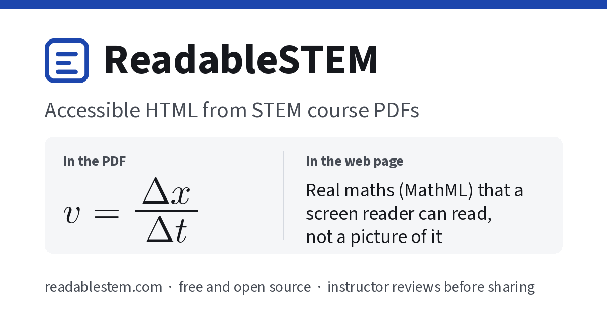
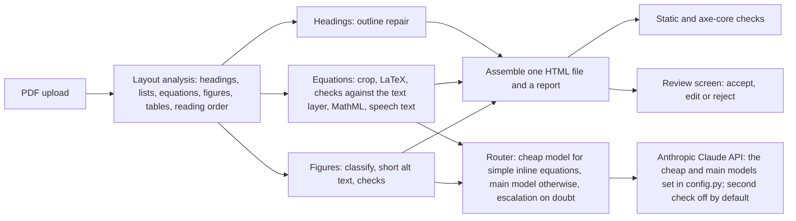

# ReadableSTEM

[](https://github.com/harishm17/readablestem/actions/workflows/ci.yml)
[](LICENSE)

ReadableSTEM (formerly a11y-stem) assists instructors who need to turn a STEM course PDF into an
accessible web page. It reads the PDF, rebuilds equations as MathML a screen reader can speak,
restores headings and lists, writes short alt text for figures, and returns one self-contained
HTML file. Every change it is unsure about goes to a review screen where the instructor accepts,
edits or rejects it.

It assists; it does not certify. Nothing here establishes conformance with WCAG, the ADA or any
other standard, and the output still needs a person to look at it, which is what the review
screen is for.

[](https://readablestem.com/demo)

| | |
|---|---|
| Try it | [readablestem.com](https://readablestem.com), a free beta; the [demo](https://readablestem.com/demo) needs no sign-in |
| See a converted page | [`src/readablestem/web/demo/index.html`](src/readablestem/web/demo/index.html), with the PDF it came from beside it |
| Results | [In brief](#results) below; every result in [docs/results.md](docs/results.md) |
| Run it | [Quick start](#quick-start) |
| Find your way around | [Repository layout](#repository-layout) and the [documentation index](docs/README.md) |

**Status.** Beta, built and maintained by Harish Manoharan. Anyone with a Google account can sign
in at https://readablestem.com (the beta runs `SIGNUP_MODE=open`; the code's default is
`allowlist`, invitation only), with daily limits for new accounts.
The pipeline's version is `PIPELINE_VERSION` in `src/readablestem/pipeline/run.py`. Questions go to hello@readablestem.com.

## What it does

- **Equations** become MathML. A model reads the crop and proposes LaTeX; deterministic checks
  compare it with the PDF's own text layer (letters, digits, signs, bold and double-struck
  styles); anything that could change what a student reads goes to review.
- **Headings** become real `<h1>` to `<h6>` in a repaired outline. Uncertain ones are grouped so
  a repeated label is one decision, not eleven. A tagged PDF's own headings count.
- **Lists** become real `<ul>` and `<ol>` with their nesting and numbering, with no model call.
- **Figures** get short alt text, or an explicit "needs a description" flag; long descriptions
  are on in the beta.
- **Tables** are detected and rebuilt with header cells (on in the beta, behind `FEATURE_TABLES`).
- **Chemistry** formulas, ions and reactions are written as mhchem (`\ce{...}`), converted to
  MathML and read aloud as chemistry. It is the weakest area ([docs/chemistry.md](docs/chemistry.md)).
- **Slides.** A Beamer deck is read frame by frame; each frame title is a heading.
- **Scans and handwriting** are converted only on request (an upload option): a model reads each
  page's picture, every converted equation and table is for a person to check, and the original
  page stays in the file. Without the request those pages are kept as images and flagged.
- **LaTeX source.** A `.tex` file or a zip of a LaTeX project is read through LaTeXML in a
  sandbox (on at readablestem.com since 2026-11-04; the PDF stays the main path).
- **Downloads and sharing.** One self-contained HTML file, the same document as Word (.docx)
  and EPUB, a zip for a Canvas page and an IMS Common Cartridge. A document can be shared with
  named people, to view or to review it.

**What it is not.** It is not a compliance checker, not an OCR engine and not a general
PDF-to-Markdown converter. It starts from the PDF; a Word or PowerPoint file is first turned into
a PDF, on a server set up for that.

## Results

There are two kinds of number, and they must not be mixed: numbers measured on documents the
system had never been run on, with the protocol written down before the run, and numbers from
the sample the checks were developed on. [docs/results.md](docs/results.md) has every result
with its tables, intervals, costs and what it does not show. The short version:

**Newest registered result (fresh5, 2026-11-04, pipeline 0.5.9).** 26 documents the system had
never seen (12 arXiv papers, 6 OpenStax sections, 8 course LaTeX documents), 131 pages, 1,715
equations, run once under a registration merged before the first request.

| Strata A to C, 26 documents, 1,715 gold equations | ReadableSTEM | Chatbot, Opus | Chatbot, Haiku |
|---|---|---|---|
| Spoken-equal, end to end (primary) | 0.840 [0.791, 0.876] | 0.836 [0.778, 0.878] | 0.816 [0.750, 0.860] |
| Exact match (secondary) | 0.793 [0.736, 0.834] | 0.770 [0.704, 0.824] | 0.732 [0.657, 0.793] |
| Cost per page | $0.0222 | $0.0681 | $0.0017 |

On the primary score ReadableSTEM and the Opus chatbot show no difference this set can detect
(+0.004, 97.5% interval [-0.023, +0.036]), at about a third of the chatbot's cost per page. The
registered claim that ReadableSTEM beats the chatbot baseline on equations is **not made**.
A separate stratum of 3 OpenStax chemistry sections (123 equations) is not a success: 0.333
right as chemistry against the registered 0.80. How many wrong equations pass without a decision is being scored again, so no
figure is stated for it. Report: [docs/eval-equation-fresh5.md](docs/eval-equation-fresh5.md).

**Earlier and other results**, each in [docs/results.md](docs/results.md):

| Result | When | What it showed |
|---|---|---|
| [First registered held-out run](docs/results.md#first-registered-held-out-result-2026-10-14), 15 OpenStax sections, replayed byte for byte by `make proof` ([PROOF.md](PROOF.md)) | 2026-10-14, pipeline 0.4.0 | Equations exactly right end to end 0.504; heading F1 0.961 with every matched heading's level right; 0.971 of figure descriptions passed a model judge; 1.76 required decisions per page. The comparison with the chatbot recipe and three open parsers is in the report |
| [The same sections, measured again](docs/results.md#re-measurement-on-the-same-sections-2026-10-21-not-a-blind-result) | 2026-10-21, pipeline 0.5.0 and later | Equations 0.596. Not a blind result: the sections had been examined since the registered run |
| [Scanned and handwritten pages](docs/results.md#scanned-and-handwritten-pages-converted-on-request-2026-10-21) | 2026-10-21 and later | 0.66 of equations exactly right on 9 real papers as scans; 0.566 on 24 held-out pages of real handwriting, with no wrong equation left without a decision |
| [Development sample](docs/results.md#development-sample-pipeline-040-2026-10-12) | 2026-10-12 | The numbers the CI regression gate compares against. The rules were tuned on these pages, so they flatter the system |

None of these numbers comes from testing with screen-reader users, and automated HTML checks
find only what a machine can find.

## How it works



A FastAPI app wraps the pipeline with sign-in (open to anyone with a Google account, or by
allowlist), spend caps, daily limits and short retention (uploads are deleted 24 hours after the
last activity, or after 7 days or 30 days if the user chooses). Every model request reserves its
worst-case cost before it is sent. Logs carry counts and category codes, never document content.
Each stage has its own document, listed in [docs/README.md](docs/README.md); the reasons for the
main choices are in [docs/decisions/](docs/decisions/).

## Quick start

Requires [uv](https://docs.astral.sh/uv/) and Python 3.12 or newer.

```
git clone https://github.com/harishm17/readablestem.git
cd readablestem
uv sync
uv run readablestem convert tests/fixtures/layout/latex/problem_set.pdf --out out.html --fake
```

`--fake` answers every model request offline with placeholder output, so the whole flow runs for
free and shows the plumbing, not the quality. For real conversions, copy `.env.example` to
`.env`, set `MODEL_PROVIDER=anthropic` and `ANTHROPIC_API_KEY` (Claude is the provider the beta
and the held-out evaluation use; the code's default is `MODEL_PROVIDER=openai` with
`OPENAI_API_KEY`, which works as an alternative), and give every run a spend cap:

```
uv run readablestem convert my.pdf --out my.html --max-usd 1.00 --report my.json
```

To run the web app locally, with no sign-in provider and no key:

```
cp .env.example .env     # then set ENV=dev, DEV_LOGIN_ENABLED=true, FAKE_MODELS=true
uv run readablestem users allow you@example.org --admin
uv run readablestem serve   # http://127.0.0.1:8000, sign in at /dev-login
```

Settings are listed in [`.env.example`](.env.example) and explained in
[docs/web.md](docs/web.md). Deployment on Railway is in
[docs/deploy-railway.md](docs/deploy-railway.md); the Google Cloud Run alternative is in
[docs/deploy.md](docs/deploy.md). `uv run readablestem ops launch-check` lists the checks a
deploy has to pass.

## Check and reproduce

| Command | What it does | Needs |
|---|---|---|
| `make check` | ruff and the offline test suite | nothing |
| `make ci-local` | what CI runs, on Python 3.12 and 3.14 | nothing |
| `make reproduce` | checks every answer-key file against its manifest, checks that each committed report was scored against that data, shows the scorer's ceiling, and prints the committed numbers (read from file, not re-run) | a few seconds; no key, no network |
| `make reproduce-rerun` | also re-runs the two tasks that call no model (headings and tables) and compares them with the committed reports | network on the first run, Chromium, two font packages ([docs/development.md](docs/development.md)) |
| `make proof` | replays the recorded held-out run, the chatbot and parser arms included, and writes `PROOF.md` byte for byte | about ten minutes; no key, no network; at the tag `proof-heldout-2026-10` ([docs/proof.md](docs/proof.md)) |

The model numbers cost money to make and differ a little on every run, so `make reproduce` does
not repeat them; it prints the commands with their spend caps. CI also runs the Postgres tests,
the browser tests with axe-core, a Docker build, a secret scan over the full history, and an
eval regression gate that compares each tracked metric with the committed baselines in
`data/eval/` ([docs/eval.md](docs/eval.md), "How to rerun").

## Repository layout

| Path | What is there |
|---|---|
| [`src/readablestem/pipeline/`](src/readablestem/pipeline/) | Reading a PDF and building the page: layout, equations, figures, tables, speech text, the HTML, Word and EPUB writers |
| [`src/readablestem/source/`](src/readablestem/source/) | The Word and LaTeX source readers and the LaTeXML sandbox |
| [`src/readablestem/models/`](src/readablestem/models/) | Model clients, routing between the cheap and the main model, prices and spend caps |
| [`src/readablestem/web/`](src/readablestem/web/) | The FastAPI app: routes, templates, the review screen, the public pages and the stored demo |
| [`src/readablestem/eval/`](src/readablestem/eval/), [`gold/`](src/readablestem/gold/), [`proof/`](src/readablestem/proof/) | The measurement code: scorers, answer keys, the recorded proof run |
| [`src/readablestem/cli/`](src/readablestem/cli/), [`ops/`](src/readablestem/ops/) | The `readablestem` command, and what runs on a schedule or before a deploy (retention, backups, the launch check) |
| [`tests/`](tests/) | The offline suite; [`tests/workflows/`](tests/workflows/) runs whole documents end to end |
| [`docs/`](docs/) | One document per stage, the evaluation reports and the [decision records](docs/decisions/); start at [docs/README.md](docs/README.md) |
| [`data/`](data/) | Answer keys, registrations and the committed evaluation reports (`data/eval/`) |
| [`proof/`](proof/), [`PROOF.md`](PROOF.md) | The first registered held-out run: its registration and addenda, the recorded model answers, and the report replayed from them |
| [`site/`](site/) | A static reviewer demo built by `make site` ([docs/site.md](docs/site.md)) |
| [`scripts/`](scripts/) | Measurement and maintenance scripts |
| [`migrations/`](migrations/), `alembic.ini` | The database schema |
| `Dockerfile`, [`.railway/`](.railway/), [`deploy/`](deploy/) | The container, the Railway project as code, and the Cloud Run alternative |
| [`PRODUCT.md`](PRODUCT.md), [`DESIGN.md`](DESIGN.md) | The product brief and the design system of the web app |
| [`CHANGELOG.md`](CHANGELOG.md) | Every change, by pipeline version |

## Limits

The live limits are on the site's [Known limits](https://readablestem.com/limits) page. The main
ones:

- **A model is in the loop.** Pictures cut from a document and the text around them, and, with
  the settings that send them, pictures of whole pages (scanned pages the instructor asks to
  have converted, or pages that hold math; the list is `sent_material` in
  `src/readablestem/web/recipients.py`, and the privacy page prints it), are sent to Anthropic's
  Claude API (the beta's provider), or to OpenAI's API (with `store=False`) if you set
  `MODEL_PROVIDER=openai`. Models are not deterministic, so two runs on the same file can differ.
- **Equations are the hard part.** On the newest registered test 0.840 of equations were spoken
  the same as the original end to end. A symbol, sign or relation that differs from the PDF's
  text layer is sent to review, but an error that agrees with the text layer, or a PDF with no
  usable text layer, can still pass.
- **Scans and handwriting** are converted only on request, and a model can misread handwriting
  and small symbols. The accuracy is measured on synthetic scans, nine papers and 24 held-out
  handwritten pages ([docs/eval-image-pages.md](docs/eval-image-pages.md),
  [docs/eval-handwriting.md](docs/eval-handwriting.md)).
- **Tables** a detector misses stay paragraph text or a picture; full-extent recall on a small
  set of real documents is 0.56 ([docs/tables.md](docs/tables.md)).
- **Figure alt text is short.** Long descriptions and chart data tables are on in the beta and
  have not yet been measured on a held-out set.
- **Formats and sizes.** readablestem.com takes PDF and LaTeX; Word and PowerPoint files are
  taken only on a server with LibreOffice. Beamer source and zips of several documents are built
  but still off there ([docs/deploy-railway.md](docs/deploy-railway.md), "Feature flags in
  production"). One upload is 100 pages and 50 MB by default; a bigger file, up to 500 pages and
  100 MB, is kept so you can choose which pages to convert, in parts. A new account has 150
  pages a day (the settings are in [`.env.example`](.env.example)).

## Documentation

[docs/README.md](docs/README.md) says which document answers which question. Good starting
points: [docs/results.md](docs/results.md) (every result), [docs/eval.md](docs/eval.md) (how
quality is measured and what the numbers leave out) and the
[decision records](docs/decisions/).

The history of this repository was rewritten once before it was made public, so the commit
hashes cited in `PROOF.md` and in the registration addenda are not the hashes you see here.
[docs/history-commit-map.txt](docs/history-commit-map.txt) lists each original hash and its
public one (original first), so the order of events can be checked.

## License

The code is MIT ([LICENSE](LICENSE)). The hosted service links PyMuPDF, which is AGPL-3.0, so
the service is offered under AGPL-3.0 terms and links this repository's complete source from the
"Source code" link in every page footer; the license is also on the Terms page. OpenStax
material used as answer keys, in the demo and in test fixtures is CC BY 4.0 with attribution;
documents under `data/authored/` are MIT. The full list of which files are under which license,
and the third-party packages, is in [THIRD_PARTY_NOTICES.md](THIRD_PARTY_NOTICES.md).
ReadableSTEM is not affiliated with or endorsed by OpenStax.

## How it was built

I designed and built ReadableSTEM. The design, the evaluation protocol, the review of every
change and every decision are mine.

## Contributing and security

See [CONTRIBUTING.md](CONTRIBUTING.md) and [SECURITY.md](SECURITY.md).
