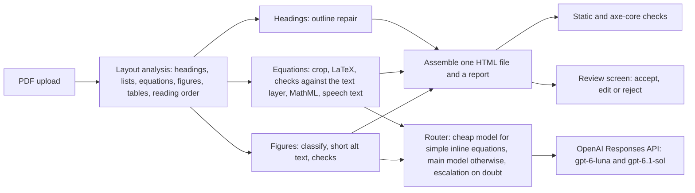

# a11y-stem

[](https://github.com/harishm17/a11y-stem/actions/workflows/ci.yml)
[](LICENSE)

a11y-stem assists instructors who need to turn a STEM course PDF into an accessible web
page. It reads the PDF, rebuilds equations as MathML a screen reader can speak, restores
headings and lists, writes short alt text for figures, and returns one self-contained HTML
file. Every change it is unsure about goes to a review screen where the instructor accepts,
edits or rejects it.

It assists; it does not certify. Nothing here establishes conformance with WCAG, the ADA or
any other standard, and the output still needs a person to look at it. That is what the
review screen is for.

**What it is not.** It is not a compliance checker. It is not an OCR engine for scans or
handwriting (those pages are kept as images and flagged). It is not a general PDF-to-Markdown
converter, and it does not work from Word, LaTeX or PowerPoint sources: it starts from the
PDF.

**Status.** Pre-release. The code, the evaluation harness and the documentation are here; a
hosted, allowlisted beta is planned for 9 November 2026.
<!-- BETA_URL: add the live link and a short screen recording here only after the smoke test passes and the uptime monitor is on. -->

## See it

A converted page is committed so you can judge the output without running anything: open
[`src/a11y_stem/web/static/demo/index.html`](src/a11y_stem/web/static/demo/index.html) in a
browser. It is OpenStax *Physics* section 2.3, converted with the real models; the PDF it
came from sits beside it. The page shows the pipeline's proposals as they came, including a
mistake that the review screen asks about (a plain *v* where the book has a bold vector).

## Results

There are two kinds of number here, and they must not be mixed. The first kind is measured
on documents the system had never been run on, with the protocol written down before the
run. The second kind comes from the sample on which the checks were developed.

### Held-out results: not available yet

**No held-out number exists for a11y-stem's equations, figures, invented content or whole
documents, nor for the chatbot recipe, and none is quoted here.** The protocol was written and
frozen before any system ran, and the harness is built and tested, but the recording could not
be made: on 2026-10-13 the OpenAI account used for the evaluation ran out of credit before any
run finished (the API answered `credit_balance_exhausted`). The attempts that failed produced
no output and nothing in them was looked at. The run is one script away once the account has
credit (below).

**What exists without a model.** Two parts of the held-out run need no model call and were
made: a11y-stem's heading detection, and the three open parsers that run on a CPU. They are in
[`proof/interim/INTERIM-heldout-2026-10.md`](proof/interim/INTERIM-heldout-2026-10.md), with
the inputs and outputs, and `make proof-interim` rebuilds the report. The headline, with 95%
intervals from resampling the 15 sections (approximate with this few; they tend to be a little
narrow):

| Heading F1 (509 gold headings) | a11y-stem | Docling | MinerU (basic) | PyMuPDF4LLM |
|---|---|---|---|---|
| F1 | 0.961 [0.947, 0.977] | 0.910 [0.842, 0.958] | 0.923 [0.894, 0.955] | 0.830 [0.738, 0.919] |
| Level of the heading right (among matched) | 1.000 | 0.031 | 0.165 | 1.000 |

At the corrected level for the comparisons the registration plans (99.375%), a11y-stem's
heading F1 is higher than MinerU's and PyMuPDF4LLM's, and no difference can be detected
against Docling's. Docling and MinerU write every heading at one level in their Markdown
export, which is a property of that export. On equations the only parser that writes LaTeX in
its default settings, MinerU, transcribes 238 of 1,369 equations exactly (0.174, 95% interval
0.108 to 0.218); Docling and PyMuPDF4LLM write none by design. **Those are the only held-out
numbers there are.**

What is fixed already, and can be checked now:

| What | Value |
|---|---|
| Sections | 15 sections of 5 OpenStax books (College Physics, Chemistry, Precalculus, Introductory Statistics, Intermediate Algebra), 242 Letter pages |
| Answer key | 1,369 equations, 509 headings, 70 figures (69 with an OpenStax alt text) |
| Licence | the retired first editions, which are CC BY 4.0; the current editions are CC BY-NC-SA and were not used |
| Choice | a seeded rule on input properties only, with every section used in development excluded; the rule and its code are in the registration |
| Registration | [`proof/PREREGISTRATION.md`](proof/PREREGISTRATION.md), SHA-256 `8127b143cdbf278f9a14650e086c70b4af7063d789b16ffdfc266399e5d4c5d9`, and the answer key's manifest `e9e7e429a5ce20ebc36c4c313ea46a8754d8b47cad6d359ec5dfb7f14d899ceb`, checked before a run |
| Scorer ceiling (answer key only, no model) | known-correct LaTeX written by hand for 40 of the 1,369 equations scores 28 of 40 under the lenient scorer (0.70, Wilson 95% 0.55 to 0.82), because OpenStax writes signs, degrees and units inside number or text tokens; a perfect transcriber is not scored 1.0, and every system pays the same. The 40 were written by me and not yet checked by the author |
| Compared | a11y-stem against the chatbot recipe instructors copy (Purdue's one-sentence prompt, on gpt-6.1-sol and gpt-6-luna) and against Docling, MinerU and PyMuPDF4LLM, on equations, headings, figures and invented content |
| Not measured | whether a wrong equation changes the meaning, and whether the figure judge agrees with a person: those labels are the author's and do not exist yet |

Run it with `ENV_FILE=/path/to/.env proof/record-heldout.sh` (about $27 of API calls by the
registration's estimate; caps $12 and $10), then `make proof` writes `PROOF.md`. The
recording code, the caps and the reproduction path are described in
[docs/proof.md](docs/proof.md). The whole path from answer key to `PROOF.md`, including the
chatbot and parser arms, runs today on the development sample below: `make proof` replays the
recorded run and writes [PROOF.md](PROOF.md) in under a minute with no key. That report is for the
development sample, and says so on top.

### Development sample (pipeline 0.4.0, 2026-10-12)

Three sections of OpenStax *Physics* chapter 2 (CC BY 4.0). The detection and review
rules were tuned on these pages, so these figures flatter the system. They are listed
because they are committed and reproducible, and because the regression gate will compare
against them once baselines are promoted.

| Task | n | Result | Cost |
|---|---|---|---|
| Equations | 30 | `exact_lenient` 0.767 (95% CI 0.591 to 0.882); a perfect transcriber scores 0.833 here, because of known gaps in the scorer; mean TEDS 0.864 | $0.0017 per equation |
| Headings | 121 | recall 1.000 (CI 0.969 to 1.000), level accuracy 0.992, precision 0.877 (138 predicted against 121 gold; the 41 least certain went to review) | no model call |
| Figures | 13 | judge pass 1.000 (CI 0.772 to 1.000); the judge is a model and is not yet calibrated against human labels | $0.0039 per figure |
| Whole pages | 3 sections, 43 PDF pages | equation recall 1.000, precision 0.545 (0.968 without prose maths); 0 static and 0 axe-core violations; 0.233 required decisions per PDF page, of which 6 of 10 pointed at a real error | $0.0034 per PDF page; median 33 s per section (n = 3) |
| Tables (local mode, no model; off by default) | 197 tables | recall 0.909 (CI 0.857 to 0.958), precision 0.984 (CI 0.953 to 0.994), TEDS 0.866 | no model call |

What these numbers do not show is as important as the numbers.

- **Small samples.** One equation is 3.3 points of `exact_lenient`. One figure is 7.7 points.
- **Clean inputs.** Rendered equations and printed pages are tidier than real course PDFs:
  no scans, no handwriting, no slides, one set of fonts. Expect real documents to score lower.
- **The review screen does not catch everything.** In the whole-page run, 3 of the 25
  scorable equations were wrong once the scorer's known gaps are set aside; the review
  screen asked about 1 of them. The other two are cosmetic by the project's policy (a bold
  subscript, a comma). No meaning-level error was accepted silently in this sample, but 30
  equations cannot rule it out.
- **Automated HTML checks find only what a machine can find.** Zero violations does not
  mean a page is usable with a screen reader, and these numbers do not come from testing with
  screen-reader users.

Method, definitions and every table: [docs/eval.md](docs/eval.md).

## What it does

- **Equations** become MathML. A model reads the crop and proposes LaTeX; deterministic
  checks compare it with the PDF's own text layer (letters, digits, signs, bold and
  double-struck styles); anything that could change what a student reads goes to review.
- **Headings** become real `<h1>` to `<h6>` in a repaired outline. Uncertain ones are grouped
  so a repeated label is one decision, not eleven.
- **Lists** become real `<ul>` and `<ol>` with their nesting and numbering, with no model call.
- **Figures** get short alt text, or an explicit "needs a description" flag. Long
  descriptions are built but off by default.
- **Tables** are detected and rebuilt with header cells behind a feature flag that is off by
  default, until they have been checked on real documents.
- **Pages it cannot read** (scans, handwriting) are kept as images with a note, not guessed at.

## How it works



A FastAPI app wraps the pipeline with sign-in, an allowlist, spend caps and short retention
(uploads are deleted after 24 hours unless the user opts in to 30 days). Every model request
reserves its worst-case cost before it is sent. Logs carry counts and category codes, never
document content. The architecture, its module contracts and the rules every part follows
are in [docs/design/beta-architecture.md](docs/design/beta-architecture.md); the reasons for
the main choices are in [docs/decisions/](docs/decisions/).

## Quick start

Requires [uv](https://docs.astral.sh/uv/) and Python 3.12 or newer.

```
git clone https://github.com/harishm17/a11y-stem.git
cd a11y-stem
uv sync
uv run a11y-stem convert tests/fixtures/layout/latex/problem_set.pdf --out out.html --fake
```

`--fake` answers every model request offline with placeholder output, so the whole flow runs
for free and shows the plumbing, not the quality. For real conversions, copy
`.env.example` to `.env`, set `OPENAI_API_KEY`, and give every run a spend cap:

```
uv run a11y-stem convert my.pdf --out my.html --max-usd 1.00 --report my.json
```

To run the web app locally, with no sign-in provider and no key:

```
cp .env.example .env     # then set ENV=dev, DEV_LOGIN_ENABLED=true, FAKE_MODELS=true
uv run a11y-stem users allow you@example.org --admin
uv run a11y-stem serve   # http://127.0.0.1:8000, sign in at /dev-login
```

Settings are listed in [`.env.example`](.env.example) and explained in
[docs/web.md](docs/web.md). Deployment to Google Cloud Run is in
[docs/deploy.md](docs/deploy.md).

## Reproduce the results

```
make reproduce
```

Takes a few seconds and needs no API key, no network and no browser. It checks every gold
file against its manifest, checks that each committed report was scored against exactly that
gold data, runs the scorer on known-correct LaTeX to show its ceiling, and prints the
committed numbers, labelled as read from file and not re-run.

The model numbers cost money to make and differ a little on every run, so `make reproduce`
does not repeat them. It prints the commands, with their spend caps (about $0.30 for the
three model tasks on the development sample). `make reproduce-rerun` also re-runs the two
tasks that call no model (headings and tables) and compares them with the committed
reports; that needs network on the first run, Chromium and two font packages
([docs/development.md](docs/development.md)). `make proof` is the other path: it replays a
recorded model run, the chatbot and parser arms included, and writes `PROOF.md` byte for byte
(no key, no network). The held-out run's commands are in [docs/proof.md](docs/proof.md).

Tests: `make check` runs ruff and the offline test suite; `make ci-local` runs what CI runs,
on Python 3.12 and 3.14. CI also runs the Postgres tests, the browser tests with axe-core,
a Docker build and a secret scan over the full history. It has an eval regression gate too,
which stays idle until baseline reports are promoted (`docs/eval.md`, "How to rerun").

## Limits

- **PDF in, HTML out.** Word and PowerPoint files must be exported to PDF first. Uploads are
  limited to 30 pages and 20 MB by default.
- **A model is in the loop.** Document images and the text around them are sent to OpenAI's
  API (with `store=False`). Models are not deterministic, so two runs on the same file can
  differ.
- **Equations are the hard part.** On the development sample 23 of 30 equations match the
  answer key under the lenient scorer, and 5 of the 7 misses are gaps in the scorer, not in
  the transcription. A symbol, sign or relation that differs from the PDF's text layer is
  sent to review, but an error that agrees with the text layer, or a PDF with no usable text
  layer, can still pass.
- **Scans, handwriting and drawings** are kept as images and flagged, not converted.
- **Tables** are off by default and have been checked on a local benchmark and the sample,
  not on a broad set of real course PDFs.
- **Figure alt text is short.** It describes; it does not replace a long description for a
  complex diagram.
- **Beta.** Sign-in is by allowlist, with spend caps and daily quotas. The privacy, terms and
  known-limits pages are drafts until the author has reviewed them.

## Documentation

[docs/README.md](docs/README.md) says which document answers which question. The most useful
starting points are [docs/eval.md](docs/eval.md) (how quality is measured and what the numbers
leave out), [docs/design/beta-architecture.md](docs/design/beta-architecture.md) and the
[decision records](docs/decisions/).

## Licence

The code is MIT ([LICENSE](LICENSE)). The hosted service links PyMuPDF, which is AGPL-3.0, so
the service is offered under AGPL-3.0 terms and links this repository's complete source in
every page footer. OpenStax material used as answer keys, in the demo and in test fixtures is
CC BY 4.0 with attribution; documents under `data/authored/` are MIT. The full list of which
files are under which licence, and the third-party packages, is in
[THIRD_PARTY_NOTICES.md](THIRD_PARTY_NOTICES.md). a11y-stem is not affiliated with or
endorsed by OpenStax.

## How it was built

Built with AI coding agents working from my specifications. I own the design, the
evaluation protocol, the review and every decision.

## Contributing and security

See [CONTRIBUTING.md](CONTRIBUTING.md) and [SECURITY.md](SECURITY.md).
