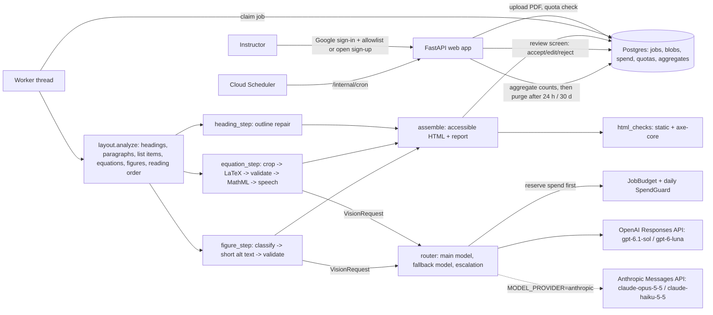

# Beta architecture (2026-10-07)

Status: the architecture the beta is built to; kept up to date as the code changes. The
decisions it rests on are in `docs/decisions/` (0001 scope, 0002 models, 0003 PDF library
and AGPL, 0004 web stack, 0005 second automated check). The "WP" column of the module
map names the work package, a unit of the original build plan, that owns each contract.

## What the app does

An instructor signs in (Google; allowlisted, or with `SIGNUP_MODE=open` any verified account), uploads a PDF of course material, and gets
back one self-contained HTML file where:

- equations are MathML a screen reader can speak (image -> LaTeX -> MathML),
- headings are real `<h1>`-`<h6>` in a repaired outline,
- lists are real `<ul>`/`<ol>` with their nesting and numbering (layout reports each item
  as a `Kind.LIST_ITEM` element; no model call),
- figures have short alt text (or an explicit "needs a description" flag),
- every fix carries a confidence and the checks it passed; the ones whose mistakes would
  change what a student reads go to a review screen where the instructor accepts, edits
  or rejects them; small things are accepted and listed as optional checks (see "Review
  tiers" below).

It "assists". It never claims WCAG/ADA compliance.

## Module map and contracts

Signatures below are fixed. Each work package (WP) implements its own; tests live in
`tests/test_<area>_*.py`. The content features of pipeline 0.4.0 (tables, long
descriptions, links and language, colour, notation memory, the job page, Microsoft
sign-in) have their own contracts, flags and ownership map in
[content-features.md](content-features.md).

| Module | Contract | WP |
|---|---|---|
| `config.py` | `Settings`, `get_settings()`, `check_production()` | spine |
| `core/types.py` | `Element`, `Fix`, `Check`, `ModelCall`, `DocumentResult`, `ConversionOutput` | spine |
| `core/triage.py` | `units`, `required_decisions`, `open_decisions`, `tier_reasons`, `review_load(fixes) -> ReviewLoad` | review triage |
| `core/budget.py` | `SpendGuard`, `InMemorySpendGuard`, `JobBudget`, `BudgetExceeded` | spine |
| `models/base.py` | `VisionRequest`, `VisionClient.run(request, schema, *, is_fallback)`, `fence_untrusted` | spine |
| `models/pricing.py` | `PRICES`, `cost_usd`, `estimate_max_cost_usd` | spine |
| `models/fake.py` | `FakeVisionClient` | spine |
| `models/openai_client.py` | `OpenAIVisionClient(settings, budget, *, client=None)` | WP1 |
| `models/anthropic_client.py` | `AnthropicVisionClient(settings, budget, *, client=None, http_client=None)`: the same `VisionClient` contract on the Anthropic Messages API | provider |
| `models/__init__.py` | `make_vision_client(settings, budget, *, fake)` (the app), `make_live_client(settings, budget)` (CLI, eval, proof; checks the key first): both pick the client from `Settings.model_provider` | provider |
| `models/router.py` | `call_with_fallback(client, request, schema, *, settings)` | WP1 |
| `models/prompts/` | versioned prompt text files + loader `load_prompt(name) -> (version, text)` | WP1 |
| `pipeline/layout.py` | `analyze(pdf_bytes, *, pages, max_pages) -> Layout` (elements: headings, paragraphs, list items, equations, figures; `page_types`, `kept_pages`), `crop(...)`, `release(pdf_bytes=None)`, `LayoutError` | WP2 |
| `pipeline/page_type.py` | `classify(page, raw_blocks, drawings, *, budget, producer) -> PageTypeResult`, `kept_reason`, `ink_regions`, `refusal_code`, `document_refusal(doc)`, `span_hidden(span)` (hidden text and page types, docs/layout.md) | page safety |
| `pipeline/heading_step.py` | `heading_fixes(elements) -> list[Fix]` | WP2 |
| `pipeline/validate.py` | `check_latex`, `safe_latex_to_mathml`, `check_mathml`, `check_alt` | WP3 |
| `pipeline/speech.py` | `mathml_to_speech(mathml) -> str` | WP3 |
| `pipeline/equation_step.py` | `transcribe(element, png, *, client, settings, context_text) -> Fix` | WP3 |
| `pipeline/signs.py` | `compare_signs(text_layer, mathml) -> SignComparison \| None` | sign check |
| `pipeline/figure_step.py` | `describe(element, png, *, client, settings, context_text) -> Fix` | WP3 |
| `pipeline/assemble.py` | `render_html(*, title, lang, elements, fixes, crops, source_note) -> str` | WP4 |
| `pipeline/safe_html.py` | `escape_text`, `sanitize_mathml(mathml, *, display, element_id)` | contracts |
| `pipeline/table_html.py` | `render_table(grid, *, id_prefix, math_display) -> str`, `needs_header_ids` | contracts |
| `pipeline/assemble_tables.py`, `pipeline/inline_text.py` | `render_table_element(element, fix, ctx)`; `render_inline_text(text, *, element, equation, add_style)`, `passage_attrs(element)` | contracts |
| `pipeline/table_step.py` | `rebuild(element, png, *, client, settings, context_text) -> Fix` | contracts |
| `pipeline/options.py`, `core/notation.py` | `current()`, `using(options)`; `canonical_symbol(text)`, `canonical_from_parts(base, variant, accent)` | contracts |
| `pipeline/html_checks.py` | `static_checks(html)`, `axe_checks(html)` | WP4 |
| `pipeline/run.py` | `convert_pdf(pdf_bytes, *, settings, client, pages, progress, tracer, concurrency, notice, source_note, options, stage_progress)` | WP4 |
| `web/db.py` | schema, `make_engine`, `session_scope` | spine |
| `web/*` | `create_app(settings=None, *, converter=None, client_factory=None) -> FastAPI` | WP5 |
| `ops/retention.py`, `ops/aggregate.py` | `purge_expired(factory, now)`, `delete_jobs(session, ids)`, `erase_user(session, user_id)`, `aggregate_finished(factory, now)` | WP6 |
| `observability/*` | `make_tracer(settings)`, `configure_logging(settings)` | WP6 |
| `eval/render.py`, `eval/pipeline_eval.py`, `eval/judge.py`, `eval/calibration.py`, `eval/gate.py` | eval harness | WP7 |
| `cli/{convert,serve,ops,eval_cli}.py` | `register(group, top=None)` | WP4/5/6/7 |

## Review tiers ("meaning-level only", decided by Harish 2026-10-08)

Measured on two real documents, only about 5 of 27 review requests mattered: 23 were
headings with weak evidence (11 of them the same "Teacher Support" label) and 4 were
letter-style differences, of which only one changed the meaning (a bold omega read as a
plain omega). So every fix gets a tier, and only meaning-level problems ask for a
decision.

| Tier (`Fix.review`) | Status | What it means | Examples |
|---|---|---|---|
| `required` ("Needs your decision") | NEEDS_REVIEW, FAILED or ABSTAINED | blocks "done", counted on the job page and in ops | failed or abstained conversions (kept as images); equations below the auto-accept confidence after escalation; a text-layer symbol mismatch (any letter, digit or Greek letter that differs); a sign or relation that differs from the text layer (a minus dropped or added as in `e^{-λt}` read as `e^{λt}`, `±` read as `+`, `≤` read as `<`, `=` read as `≈`, a dot product read as a cross product; since pipeline 0.3.0); a vector read as a scalar (a letter that is bold in the PDF and a plain variable in the proposal, at base level or in the script of a plain base such as `e^{i𝐤·𝐫}`, or a letter known to be plain made a bold variable); a double-struck, script or fraktur letter the text layer encodes (`ℝ`) read as a plain one; figures without a usable description (abstained, failed, an error-level alt check, a caption copy, a doubtful or self-contradicting decorative answer, low confidence); one decision per group of repeated headings |
| `optional` ("Optional checks") | ACCEPTED | accepted automatically, listed folded on the review screen with each note in plain English; never blocks "done"; still editable | cosmetic style differences (the bold label of a bold symbol such as `𝐝𝐟`, a bold digit, the lone zero vector `𝟎` too, a style the text layer cannot show such as double-struck R from MSBM, a letter of unknown weight made bold; on a cheap-model answer these still escalate to the main model); a single heading with weak evidence or a repaired level, the bold run-in labels ("Solution", "Discussion") included; alt text a little long or starting "image of"; no speech text |
| `none` | ACCEPTED | nothing to note | multiplication style (`×`, `·` or juxtaposition for scalars) and division style (`/`, `÷`, a fraction bar) are not compared at all |

- **Data model.** `Fix.review: Literal["required", "optional", "none"]`. Results stored
  before tiers existed load with the tier their status implies (`default_review`:
  needs_review, failed, abstained -> required; anything else -> none). A reviewer's
  decision changes `status` (and `reviewed`), never `review`: the tier records what the
  pipeline asked, and ops counts it. The failed checks of an optional fix are its notes
  (their codes stay in `checks`). `Fix.optional_note` is "accepted with a note nobody
  has acted on yet".
- **Heading groups.** Uncertain headings with the same label (NFKC, case-folded, letters
  and digits) and the same style (font size to 0.5 pt, weight, larger-font evidence,
  proposed level) that appear two or more times share `Fix.group_key` (content-free:
  `"hg-" + the first one's element id`) and `Fix.group_size`, and are NEEDS_REVIEW.
  They are one decision: the review screen asks once ("Teacher Support appears 11 times
  as a bold line in the body text size: keep them as headings at level 3, or make them
  bold text?") and `web.review.apply_group` applies it to every member still waiting.
- **Counting.** `core.triage` counts decisions (units), not fixes: a group is one unit.
  `DocumentStats.by_review` and `required_decisions` record the pipeline's tiers;
  `ops.aggregate` writes `tier:<tier>`, `tier:<tier>:<reason>` and
  `decisions:required` per step; the eval reports required decisions per page and flag
  precision and recall against gold (docs/eval.md "Review load").
- **Bold run-in labels** ("Solution", "Discussion", "Procedure" in an OpenStax worked
  example) are not headings in OpenStax's outline, but no structural rule separated them
  from real box headings on independent evidence (docs/layout.md "Run-in labels"), so
  they are not guessed at: alone they are optional notes, repeated they are a group.
- **Signs and relations** (decided by Harish 2026-10-08, pipeline 0.3.0): a sign or
  operator difference is meaning-level, so required (`equation.text_layer_signs`, code
  `sign_mismatch`; confidence scaled like a meaning-level style difference, so a cheap
  answer escalates first). Multiplication style is cosmetic and not even a note, except
  a dot product read as a cross product (bold vectors on both sides of the sign). The
  check only asks when the text layer's letters and digits mostly agree with the
  transcription, and ambiguous glyphs (hyphens in words, ranges, accents, unnamed
  glyphs) can never raise it on their own (docs/steps.md "Sign and relation check").
  Results and eval reports from pipeline 0.2.0 were made under the old policy.

Where it lives: `pipeline/equation_step.py` (`text_layer_symbols_differ`,
`text_layer_style`, `NOTE_CODES`), `pipeline/signs.py` (`compare_signs`),
`pipeline/heading_step.py` (`group_repeated`),
`pipeline/figure_step.py` (`NOTE_CODES`), `pipeline/layout.py`
(`Element.regular_letters`), `core/triage.py`, `web/review.py`, `web/routes/review.py`,
`web/views.py`, `ops/aggregate.py`, `ops/report.py`, `eval/pipeline_eval.py`.

The review screen asks the decisions one at a time beside the page they are on (the
Split View design, chosen 2026-10-08; docs/web.md "Review screen"): `web/queue.py`
numbers the decisions, `web/compare.py` says what differs in an equation from the step's
own rules, and `web/routes/split.py` shows each with its page, rendered on demand in the
upload probe's child process (`web/page_images.py`). The full list stays at
`/jobs/{id}/review/list`.

## Model providers

OpenAI is the default. `MODEL_PROVIDER=anthropic` (per deployment, or `--provider anthropic`
per eval or proof run) switches every model request to the Claude API; nothing else in the
pipeline knows which provider answered.

- **Roles.** The code reads `settings.main_model` and `settings.cheap_model`. With the
  OpenAI provider they are `MAIN_MODEL` / `CHEAP_MODEL` (gpt-6.1-sol, gpt-6-luna). With
  Anthropic they are `ANTHROPIC_MAIN_MODEL` (default `claude-opus-5-5`) and
  `ANTHROPIC_CHEAP_MODEL` (default `claude-haiku-5-5`; `claude-sonnet-5-5` is the other
  priced choice), and `MAIN_MODEL` / `CHEAP_MODEL` are ignored. The pairs are chosen the
  same way: the cheap model reads first, the main model re-reads what the cheap one is
  unsure about, and each is the other's fallback, so **fallback and escalation never leave
  the selected provider** (`Settings.fallback_for` is built from the resolved pair).
- **Contract.** `AnthropicVisionClient` implements `VisionClient` as `OpenAIVisionClient`
  does: reserve the worst case before every send, settle with the real usage, retry here
  (the SDK's own retries are off) with a reservation per resend, report failures as
  `ModelCall.outcome` codes, never log content. Images are base64 content blocks, the
  step's constant instructions are the cached system prefix, the fenced untrusted text is
  unchanged, and the output schema goes through `output_config.format`.
- **Model rules** (from Anthropic's reference for these models): no `temperature` or other
  sampling parameter, no assistant prefill, no forced `tool_choice`; thinking cannot be
  turned off on claude-opus-5-5, so `output_config.effort` is set on every request
  (`ANTHROPIC_EFFORT_MAIN=medium`, `ANTHROPIC_EFFORT_CHEAP=low`) and `max_tokens` is the
  step's limit plus a thinking allowance (8,192).
- **Refusal fallback.** claude-opus-5-5 (and claude-sonnet-5-5) requests carry
  `fallbacks: "default"` under the beta header `server-side-fallback-2026-07-01`:
  Anthropic re-runs a request its classifiers decline on the model it recommends, inside the
  same call. The fallback model runs without the first model's thinking, and is billed at its
  own rate (the reservation uses the dearer rate). It is on by default
  (`ANTHROPIC_REFUSAL_FALLBACK`). claude-haiku-5-5 has no server-side fallback; its refusal
  is a `refused` outcome and the router's fallback to the other model applies.
- **The second automated check is OpenAI-only.** The Decisions API (ADR 0005) belongs to
  OpenAI. With the Anthropic provider the check is skipped cleanly: `any_check_enabled` is
  false, no verifier is built, steps record no verification and the canary is not due; no
  request goes to OpenAI and no OpenAI key is needed. It was not kept on OpenAI "if a key is
  configured": that would send the same figure and equation images to a second company in a
  deployment whose privacy page names one, for a check that only ranks.
- **Records.** Eval and proof reports record the provider as `client` (`openai`,
  `anthropic`, `fake`) and the model ids as `models`. A proof recording made with Claude
  also records `model_provider` and the effort settings in its code identity; a replay takes
  the provider and the models from the recording. The recordings made before the provider
  existed carry neither and mean OpenAI, so they replay exactly as before.

### Data path and retention with Anthropic

With the Anthropic provider, Anthropic is a data processor in place of OpenAI. The data
path is the same as in the diagram: the images cut from the PDF (equations, figures, and
tables when `FEATURE_TABLES` is on) and a short fenced text around each, and with
`FEATURE_NOTATION_MEMORY` the course's notation, go to the Anthropic API over HTTPS from the
worker. Nothing else is sent: no file name, no email address, no PDF. The request carries
the API key and, when set, the workspace id.

What is known, from Anthropic's privacy centre ("How long do you store my organization's
data?", read 2026-10-13):

- Inputs and outputs of the API are deleted from Anthropic's backend within 30 days of
  receipt or generation, unless a zero-data-retention (or other) agreement says otherwise.
- Inputs and outputs that Anthropic's systems flag as Usage Policy violations can be
  retained for up to 2 years, and the classification scores for up to 7 years.
- Anthropic's commercial terms say API data is not used to train its models by default. That
  is not on the page above and was not re-checked for this change.
- This app's own retention (24 hours, 30 days with the opt-in) does not reach Anthropic's
  copy: a document deleted here can still be at Anthropic for up to 30 days.
- Not known: whether a zero-data-retention agreement is in place for Harish's account, and
  whether the account's workspace uses any retention setting other than the default.

Decided for the beta (docs/launch.md B1): the notice says "up to 30 days" (longer for
material the provider's safety systems flag), no zero data retention is requested, and the
sentence "Uploads are never used to train AI models" became "We do not use your uploads to
train models, sell them or share them beyond the services named here". The privacy page (`web/templates/privacy.html`) names Anthropic instead of
OpenAI when the provider is anthropic, with the same words as for OpenAI plus a pointer to
Anthropic's own policies; `readablestem ops launch-check` lists the page as a launch blocker on
this provider if it does not name Anthropic.

## Rules every work package follows

1. **Privacy.** Document content (text, images, LaTeX, alt text, filenames, emails) never
   goes into logs, traces, error codes or aggregate tables. Use category codes
   (`Check.code`, `Fix.reason`, `ModelCall.outcome`, `Job.error_code`).
2. **Untrusted input.** Document text only reaches a model through
   `VisionRequest.context_text` (fenced by the client). Model output is validated before
   use: LaTeX against an allowlist, MathML parsed with `defusedxml`, alt text checked, all
   HTML escaped by Jinja autoescape or `html.escape`. MathML inserted into output HTML is
   re-serialised from a parsed, allowlisted tree, never pasted as a string.
3. **Spend.** No model request without a successful reservation (`JobBudget.reserve`).
   CLI commands that call models take `--max-usd` (required) and use
   `InMemorySpendGuard`. A reservation is the request's worst case until it settles, so
   steps running at once fill a small cap before it is spent (`convert --concurrency`).
4. **Offline tests by default.** Tests use `FakeVisionClient` and generated PDFs. Real
   API tests are marked `live_model`; browser tests `browser`; Postgres tests `postgres`.
5. **The app itself is accessible.** Semantic HTML, labels on every control, visible
   focus, skip link, no information by colour alone, works without JavaScript (htmx only
   enhances), contrast >= 4.5:1. The web test suite runs axe-core on every page
   (`browser` marker).
6. **AGPL notice.** PyMuPDF is AGPL-3.0 (ADR 0003). Every page footer links to the source
   (`settings.source_url`); `THIRD_PARTY_NOTICES.md` lists it.
7. **Wording.** "Assists"; never "compliant", "ensures compliance" or "ADA/WCAG
   compliant" anywhere in the UI, output or docs.
8. **Public copy is the author's.** The README prose, the known-limits copy and the ADR
   "Consequences" sections are written or confirmed by the author. Unfinished wording is
   marked `TODO(Harish)`, and `readablestem ops launch-check` lists what is left on the
   public pages (none for the beta).
9. **Style.** Python 3.12+, ruff (line length 100), type hints that pass `ty check src`,
   docstrings that say why. No new runtime dependencies without a note in the PR.
