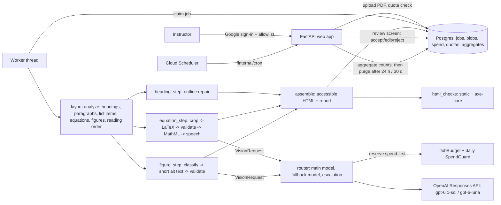

# Beta architecture (2026-10-07)

Status: built on branch `feat/beta-app` for Harish's review. Decisions it rests
on are in `docs/decisions/` (0001 scope, 0002 models, 0003 PDF library and AGPL,
0004 web stack). Product context: the private planning notes (not public).

## What the app does

An instructor signs in (Google, allowlisted), uploads a PDF of course material, and gets
back one self-contained HTML file where:

- equations are MathML a screen reader can speak (image -> LaTeX -> MathML),
- headings are real `<h1>`-`<h6>` in a repaired outline,
- lists are real `<ul>`/`<ol>` with their nesting and numbering (layout reports each item
  as a `Kind.LIST_ITEM` element; no model call),
- figures have short alt text (or an explicit "needs a description" flag),
- every fix carries a confidence and the checks it passed; the ones whose mistakes would
  change what a student reads go to a review screen where the instructor accepts, edits
  or rejects them; small things are accepted and listed as optional checks (see "Review
  tiers" below).

It "assists". It never claims WCAG/ADA compliance.

## Module map and contracts

Signatures below are fixed. Work packages (WP) implement them; tests live in
`tests/test_<area>_*.py`.

| Module | Contract | WP |
|---|---|---|
| `config.py` | `Settings`, `get_settings()`, `check_production()` | spine |
| `core/types.py` | `Element`, `Fix`, `Check`, `ModelCall`, `DocumentResult`, `ConversionOutput` | spine |
| `core/triage.py` | `units`, `required_decisions`, `open_decisions`, `tier_reasons`, `review_load(fixes) -> ReviewLoad` | review triage |
| `core/budget.py` | `SpendGuard`, `InMemorySpendGuard`, `JobBudget`, `BudgetExceeded` | spine |
| `models/base.py` | `VisionRequest`, `VisionClient.run(request, schema, *, is_fallback)`, `fence_untrusted` | spine |
| `models/pricing.py` | `PRICES`, `cost_usd`, `estimate_max_cost_usd` | spine |
| `models/fake.py` | `FakeVisionClient` | spine |
| `models/openai_client.py` | `OpenAIVisionClient(settings, budget, *, client=None)` | WP1 |
| `models/router.py` | `call_with_fallback(client, request, schema, *, settings)` | WP1 |
| `models/prompts/` | versioned prompt text files + loader `load_prompt(name) -> (version, text)` | WP1 |
| `pipeline/layout.py` | `analyze(pdf_bytes, *, pages, max_pages) -> Layout` (elements: headings, paragraphs, list items, equations, figures), `crop(...)`, `release(pdf_bytes=None)`, `LayoutError` | WP2 |
| `pipeline/heading_step.py` | `heading_fixes(elements) -> list[Fix]` | WP2 |
| `pipeline/validate.py` | `check_latex`, `safe_latex_to_mathml`, `check_mathml`, `check_alt` | WP3 |
| `pipeline/speech.py` | `mathml_to_speech(mathml) -> str` | WP3 |
| `pipeline/equation_step.py` | `transcribe(element, png, *, client, settings, context_text) -> Fix` | WP3 |
| `pipeline/figure_step.py` | `describe(element, png, *, client, settings, context_text) -> Fix` | WP3 |
| `pipeline/assemble.py` | `render_html(*, title, lang, elements, fixes, crops, source_note) -> str` | WP4 |
| `pipeline/html_checks.py` | `static_checks(html)`, `axe_checks(html)` | WP4 |
| `pipeline/run.py` | `convert_pdf(pdf_bytes, *, settings, client, pages, progress, tracer, concurrency, notice)` | WP4 |
| `web/db.py` | schema, `make_engine`, `session_scope` | spine |
| `web/*` | `create_app(settings=None, *, converter=None, client_factory=None) -> FastAPI` | WP5 |
| `ops/retention.py`, `ops/aggregate.py` | `purge_expired(factory, now)`, `aggregate_finished(factory, now)` | WP6 |
| `observability/*` | `make_tracer(settings)`, `configure_logging(settings)` | WP6 |
| `eval/render.py`, `eval/pipeline_eval.py`, `eval/judge.py`, `eval/calibration.py`, `eval/gate.py` | eval harness | WP7 |
| `cli/{convert,serve,ops,eval_cli}.py` | `register(group, top=None)` | WP4/5/6/7 |

## Review tiers ("meaning-level only", decided by Harish 2026-10-08)

Measured on two real documents, only about 5 of 27 review requests mattered: 23 were
headings with weak evidence (11 of them the same "Teacher Support" label) and 4 were
letter-style differences, of which only one changed the meaning (a bold omega read as a
plain omega). So every fix gets a tier, and only meaning-level problems ask for a
decision.

| Tier (`Fix.review`) | Status | What it means | Examples |
|---|---|---|---|
| `required` ("Needs your decision") | NEEDS_REVIEW, FAILED or ABSTAINED | blocks "done", counted on the job page and in ops | failed or abstained conversions (kept as images); equations below the auto-accept confidence after escalation; a text-layer symbol mismatch (any letter, digit or Greek letter that differs); a vector read as a scalar (a letter that is bold in the PDF and a plain variable in the proposal, at base level or in the script of a plain base such as `e^{i𝐤·𝐫}`, or a letter known to be plain made a bold variable); a double-struck, script or fraktur letter the text layer encodes (`ℝ`) read as a plain one; figures without a usable description (abstained, failed, an error-level alt check, a caption copy, a doubtful or self-contradicting decorative answer, low confidence); one decision per group of repeated headings |
| `optional` ("Optional checks") | ACCEPTED | accepted automatically, listed folded on the review screen with each note in plain English; never blocks "done"; still editable | cosmetic style differences (the bold label of a bold symbol such as `𝐝𝐟`, a bold digit, a style the text layer cannot show such as double-struck R from MSBM, a letter of unknown weight made bold; on a cheap-model answer these still escalate to the main model); a single heading with weak evidence or a repaired level; alt text a little long or starting "image of"; no speech text |
| `none` | ACCEPTED | nothing to note | |

- **Data model.** `Fix.review: Literal["required", "optional", "none"]`. Results stored
  before tiers existed load with the tier their status implies (`default_review`:
  needs_review, failed, abstained -> required; anything else -> none). A reviewer's
  decision changes `status` (and `reviewed`), never `review`: the tier records what the
  pipeline asked, and ops counts it. The failed checks of an optional fix are its notes
  (their codes stay in `checks`). `Fix.optional_note` is "accepted with a note nobody
  has acted on yet".
- **Heading groups.** Uncertain headings with the same label (NFKC, case-folded, letters
  and digits) and the same style (font size to 0.5 pt, weight, larger-font evidence,
  proposed level) that appear two or more times share `Fix.group_key` (content-free:
  `"hg-" + the first one's element id`) and `Fix.group_size`, and are NEEDS_REVIEW.
  They are one decision: the review screen asks once ("Teacher Support appears 11 times
  as a bold line in the body text size: keep them as headings at level 3, or make them
  bold text?") and `web.review.apply_group` applies it to every member still waiting.
- **Counting.** `core.triage` counts decisions (units), not fixes: a group is one unit.
  `DocumentStats.by_review` and `required_decisions` record the pipeline's tiers;
  `ops.aggregate` writes `tier:<tier>`, `tier:<tier>:<reason>` and
  `decisions:required` per step; the eval reports required decisions per page and flag
  precision and recall against gold (docs/eval.md "Review load").
- **Bold run-in labels** ("Solution", "Discussion", "Procedure" in an OpenStax worked
  example) are not headings in OpenStax's outline, but no structural rule separated them
  from real box headings on independent evidence (docs/layout.md "Run-in labels"), so
  they are not guessed at: alone they are optional notes, repeated they are a group.

Where it lives: `pipeline/equation_step.py` (`text_layer_symbols_differ`,
`text_layer_style`, `NOTE_CODES`), `pipeline/heading_step.py` (`group_repeated`),
`pipeline/figure_step.py` (`NOTE_CODES`), `pipeline/layout.py`
(`Element.regular_letters`), `core/triage.py`, `web/review.py`, `web/routes/review.py`,
`web/views.py`, `ops/aggregate.py`, `ops/report.py`, `eval/pipeline_eval.py`.

## Rules every work package follows

1. **Privacy.** Document content (text, images, LaTeX, alt text, filenames, emails) never
   goes into logs, traces, error codes or aggregate tables. Use category codes
   (`Check.code`, `Fix.reason`, `ModelCall.outcome`, `Job.error_code`).
2. **Untrusted input.** Document text only reaches a model through
   `VisionRequest.context_text` (fenced by the client). Model output is validated before
   use: LaTeX against an allowlist, MathML parsed with `defusedxml`, alt text checked, all
   HTML escaped by Jinja autoescape or `html.escape`. MathML inserted into output HTML is
   re-serialised from a parsed, allowlisted tree, never pasted as a string.
3. **Spend.** No model request without a successful reservation (`JobBudget.reserve`).
   CLI commands that call models take `--max-usd` (required) and use
   `InMemorySpendGuard`. A reservation is the request's worst case until it settles, so
   steps running at once fill a small cap before it is spent (`convert --concurrency`).
4. **Offline tests by default.** Tests use `FakeVisionClient` and generated PDFs. Real
   API tests are marked `live_model`; browser tests `browser`; Postgres tests `postgres`.
5. **The app itself is accessible.** Semantic HTML, labels on every control, visible
   focus, skip link, no information by colour alone, works without JavaScript (htmx only
   enhances), contrast >= 4.5:1. The web test suite runs axe-core on every page
   (`browser` marker).
6. **AGPL notice.** PyMuPDF is AGPL-3.0 (ADR 0003). Every page footer links to the source
   (`settings.source_url`); `THIRD_PARTY_NOTICES.md` lists it.
7. **Wording.** "Assists"; never "compliant", "ensures compliance" or "ADA/WCAG
   compliant" anywhere in the UI, output or docs.
8. **Harish writes:** README prose, the known-limits copy, the ADR "Consequences"
   sections. Leave clearly marked `TODO(Harish)` placeholders there.
9. **Style.** Python 3.12+, ruff (line length 100), type hints that pass `ty check src`,
   docstrings that say why. No new runtime dependencies without a note in the PR.
