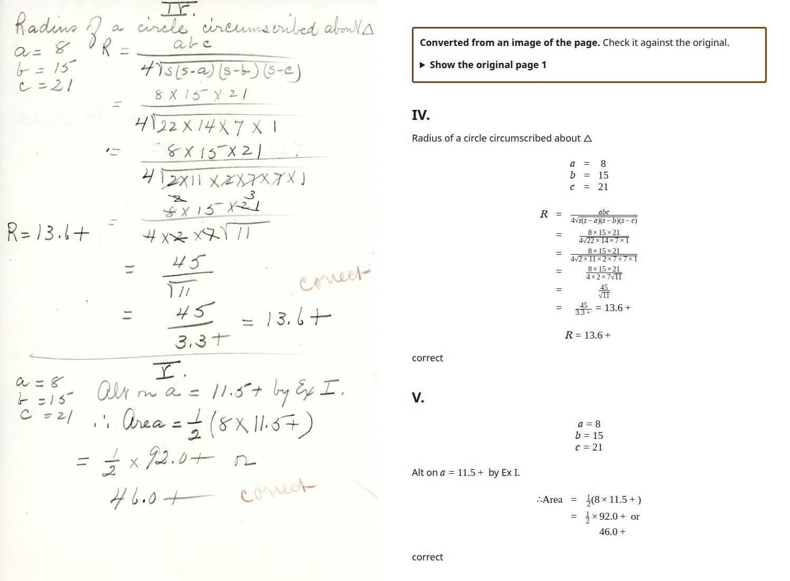
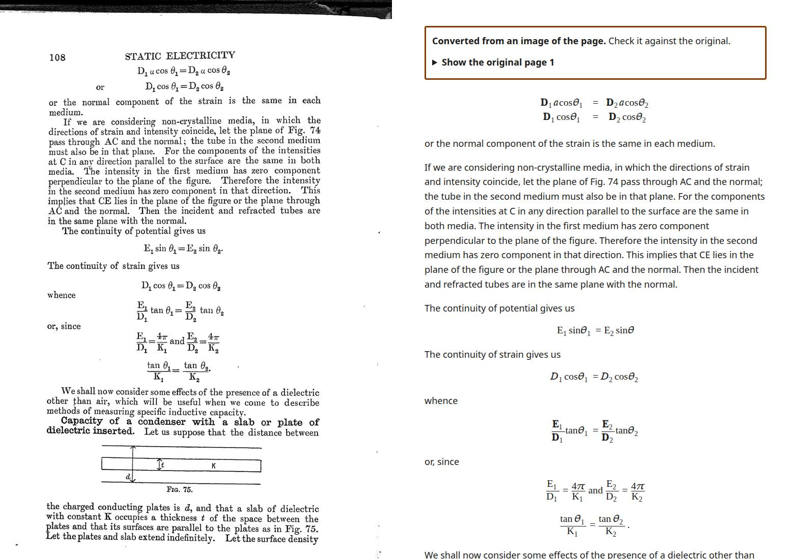
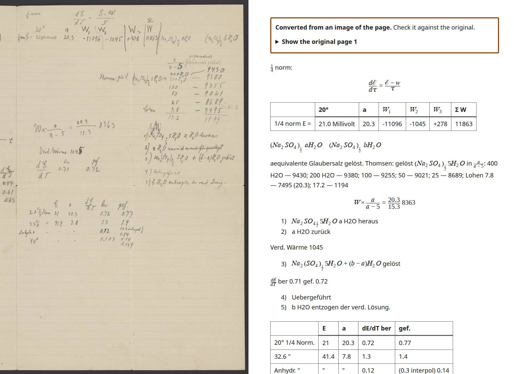

# Scanned and handwritten pages read from an image: measurement (2026-10-21)

What [ADR 0007](decisions/0007-image-pages.md) built, how it was measured, what it did, what it
cost, and what that does and does not say. Two measurements: development material (`data/dev-v2`,
dev part, turned into synthetic scans; eight public-domain or CC BY-SA real pages) and, once, the
real-world held-out papers as scans (registered before the run, partial: see "Held-out check").
The sealed check part was not run, opened or used. Every model answer was recorded once
(`--answers`) and every table below is re-scored from those recordings.

**The short version.** On 36 pages of development documents turned into synthetic scans, a page read
from its image by `claude-opus-5-5` ends with the same equations right, end to end, as the same
pages as typed PDFs through today's pipeline (0.593 on the primary `exact_lenient`, 0.834 against
0.830 on the symbols score), reads the prose at a word error rate of 3 to 5 %, and costs $0.106 a
page all in ($0.095 of it the page read) against $0.022 for the typed pages. On 9 of the 15
real-world held-out papers (42 pages) made into scans, which the feature had never seen, it ends
at 0.664 on the primary score against 0.619 for the typed pipeline on the same papers (symbols 0.693
against 0.664; the difference is inside the noise), and costs $0.136 a page. `claude-haiku-5-5`
reads the development pages for $0.003 and loses 12 points of symbols-correct equations and the
reliability of its own confidence on handwriting; `claude-sonnet-5-5` is not better than Haiku and
costs seventeen times as much. The price is review: 3.5 required decisions per page on the
development pages (1.7 on the papers, where most mathematics is inline) against 1.4 for typed pages
and 0.17 before, because no display equation or table of an image page can be accepted without a
person. **Decision (2026-10-21): ship it as an opt-in per upload with the main model, default off;**
reasons and the open risks are at the end.

## What was built

| Part | Where |
|---|---|
| The pass: prompt, strict output schema, validation, review tiers, the rescue of an unreadable crop | `src/readablestem/pipeline/image_page.py`, `src/readablestem/models/prompts/image_page.md` |
| Integration (kept pages, crops, headings, cost, notices) | `pipeline/run.py` (`_image_pages_pass`), `pipeline/layout.py` (`REASON_IMAGE_HEADING`), `pipeline/heading_step.py` unchanged |
| Output: notice, "Show the original page", about note, rejected text as a picture | `pipeline/assemble.py` |
| Review of the text of an image page; upload of scans; job outcome | `web/review.py`, `web/routes/review.py`, `web/routes/split.py`, templates, `web/pdf_probe.py`, `web/uploads.py`, `web/worker.py` |
| The upload option (per document): the checkbox, the probe's count of scanned and handwritten pages, `Job.image_pages` (migration `c4e7a2b9d150`), the job's spend allowance, large files in parts | `web/templates/app.html`, `web/routes/jobs.py`, `web/routes/parts.py`, `web/pdf_probe.py`, `web/uploads.py`, `pipeline/page_type.py` (`image_page_count`), `web/intake.py`, `web/pending.py`, `web/worker.py` (`job_caps`), `web/notation.py` (`conversion_options`), `ops/limits.py` |
| Settings | `FEATURE_IMAGE_PAGES` (the offer), `IMAGE_PAGES_MODEL`, `IMAGE_PAGES_USD_PER_PAGE`, `IMAGE_PAGES_MAX_USD_PER_JOB`, `ANTHROPIC_EFFORT_IMAGE_PAGES`, `IMAGE_PAGES_TIMEOUT_S`, `IMAGE_PAGES_DPI`, `IMAGE_PAGES_OMISSION_CHECK`, `IMAGE_PAGES_RECOVER_OMISSIONS`, `IMAGE_PAGES_SECOND_READING`, `IMAGE_PAGES_ACCEPT_AGREED`; `VisionRequest.timeout_s` |
| Eval: scans, prose word error rate, image page numbers | `eval/scan.py`, `eval/scan_media.py`, `eval/prose_wer.py`, `eval/image_pages.py`; `eval pipeline --scanned [--scan-seed]` |
| Held-out check | `data/image-pages/PREREGISTRATION-HELDOUT-SCANS.md` (+ `.sha256`), `scripts/realworld_scanned.py` |
| Dev scripts | `scripts/image_pages_probe.py` (read pages live, or a picture), `scripts/image_pages_table.py` (reports side by side) |
| Tests | `tests/test_image_page.py`, `test_image_page_run.py`, `test_web_image_pages.py`, `test_eval_scan.py`, `test_eval_image_pages.py`, `test_web_image_pages_option.py`; browser: `test_image_page_browser.py`, `test_image_page_axe_browser.py`, `test_image_page_option_browser.py` |

## How it was measured

**The set.** Six development documents, 36 PDF pages, 253 answer-key equations (116 display,
the rest inline), 76 answer-key headings: OpenStax Chemistry (Atoms First) 1.4 measurements, 12.3
second and third laws of thermodynamics, 14.1 Brønsted-Lowry acids and bases, 20.2 nuclear equations
(prose, nuclides, chemical formulas, tables, figures), and two documents written for this project:
`latex-matrices` (47 display systems and matrices) and `latex-exercises` (numbered exercises,
piecewise definitions). Chosen for variety and for their size, before any run, not for how a model
did on them; prompt and builder were developed on the first pages of these sections (a Haiku
pilot of 13 pages), so none of this is a clean confirmation set.

**Synthetic scans** (`eval/scan.py`). Each printed page is rendered at 300 dpi, resampled to 150 to
200 dpi, rotated up to 1.5 degrees, shaded towards one edge, tinted, given sensor grain (sigma 4 to 9
levels), blurred (radius 0.5 to 0.9 px) and saved as a JPEG at quality 55 to 75, then set in a PDF as the
only thing on the page. Deterministic from the seed (0 here), so the requests, and therefore the
recorded answers, replay. `page_type` calls every such page `scan_no_text`. The answer key and
scorers are the existing document task's, unchanged: equations (primary `exact_lenient`, and the
secondary symbols score), headings (the headings task's scorer), review load, cost. The same
pages as typed PDFs, with the flag off, are the comparison ("typed"); the same scans with the flag
off are "before" (every page kept as an image).

**Prose word error rate** (`eval/prose_wer.py`). Words of the whole section as one sequence each,
exact word-level Levenshtein distance, over the answer key's words (the page's own printable HTML).
Two versions: *all words*, formulas included on both sides as the MathML text they hold; and
*prose only*, formulas out of both sides and only words of three letters or more, so that two ways of
writing a formula cannot differ. The attribution block and the running footer are left out of both
(the prompt tells the reader to leave running footers out; a reader that transcribes the attribution
block is not penalised). Known quirks of the key: the printable HTML lacks the title row of some
tables, and a picture inside a table cell is described by the model (the nuclear-radiation table of
20.2): a few words per section either way, the same for every model.

**Models.** Page reader: `claude-opus-5-5` (the main model), `claude-sonnet-5-5`, `claude-haiku-5-5`,
each at effort `low`, 200 dpi. Everything else is as in production: equation step with
`claude-opus-5-5` main and `claude-haiku-5-5` cheap, no second automated check (`CLAUDE_SECOND_CHECK=off`).
Each arm is one run: there is no repeat, so a difference of a few points between arms is inside the
noise of a stochastic model on 36 pages (the effort and resolution runs below show differences of
that size from changes that should not matter much).

## Results

| | before (scans, flag off) | typed PDF (flag off) | Haiku | Sonnet | **Opus** |
|---|---|---|---|---|---|
| PDF pages / answer-key equations | 36 / 253 | 36 / 253 | 36 / 253 | 36 / 253 | 36 / 253 |
| **equations right end to end, primary `exact_lenient`** | 0.000 | 0.593 | 0.522 | 0.455 | **0.593** |
| equations right end to end, symbols (credit) | 0.000 | 0.830 | 0.715 | 0.692 | **0.834** |
| detection recall / precision | 0 / n.a. | 0.897 / 0.725 | 0.854 / 0.570 | 0.763 / 0.609 | 0.897 / 0.622 |
| heading F1 / relative level right among matched | n.a. | 0.967 / 1.000 | 0.934 / 0.634 | 0.961 / 0.743 | 0.961 / 0.662 |
| prose WER, all words (formulas included) | 1.000 | n.a. | 0.055 | 0.037 | 0.046 |
| prose WER, words of 3+ letters (formulas out) | 1.000 | n.a. | 0.024 | 0.031 | 0.034 |
| pages read / kept as image | 0 / 36 | n.a. | 36 / 0 | 36 / 0 | 36 / 0 |
| required decisions per PDF page | 0.17 | 1.42 | 3.83 | 3.83 | 3.50 |
| optional notes per page (all blocks) | 0 | 1.11 (equations, headings, figures only) | 9.56 | 8.78 | 10.19 |
| **page read: $ per page** (mean; median) | | | **0.003** (0.002) | **0.050** (0.036) | **0.095** (0.072) |
| whole pipeline: $ per PDF page | 0 | 0.022 (incl. $0.0065 of second check) | 0.015 | 0.061 | 0.106 |
| page read: seconds per page | | | 12.4 | 13.9 | 20.8 |

"Required decisions" for the image arms count every block's fix (`ImagePageRecord.required`);
for "before" and "typed" they are the existing report's number (equations, figures, tables,
headings). The two are the same kind of count, not the same thing: on typed pages prose has no fix.
The typed heading figures are the headings task on the same six documents (layout and heading
step, no model). Cost per page of the typed arm includes a shadow second check that the image arms
did not run ($0.24 of the $0.77).

**What the table says.**

- **Equations.** With Opus as the page reader the pipeline ends where it does for typed pages,
  on both scores. With Haiku it ends 7 points lower on `exact_lenient` and 12 on the symbols score.
  The reasons are in the boxes and the readings (below), not in the LaTeX: where a box is right the
  LaTeX is almost always right. Sonnet's low detection recall is a style: it wrote 79 inline
  formulas where Opus wrote 114 and left the rest as text.
- **The scorer's strictness.** The primary score fails an equation whose structure differs from the
  key's (`\text{H}_2\text{O}` against a mixed run, a system as an array against a braced list): 49 of
  Opus's 113 matched display equations "wrong" by `exact_lenient` are wrong in no way a reader would
  see. The symbols score is the better reading of the table. And the key's inline equations often
  carry the bracket or comma around them (`HCO3−)`): the 15 inline equations Opus got "wrong in
  the symbols" that were looked at are all that (the model's reading is right).
- **Prose.** 2 to 3 % of words wrong in prose and 4 to 5 % counting the formulas' tokens, all three
  models, with no model clearly ahead; the differences are the key's quirks and a described picture.
  No reader hallucinated a paragraph on these pages; none wrote `[illegible]` (the pages are legible).
- **Headings.** The reader finds the headings (F1 0.93 to 0.96 against 0.97 typed) but not their
  levels: 63 to 74 % of matched headings have the right relative level against 100 % from layout's
  font sizes. A level is one option on the review card; the outline repair keeps the document valid.
- **Review load.** 3.5 to 3.8 required decisions per page: 116 display equations, 9 tables and 2 to 4
  figures, nothing else, in every arm (prose and headings were optional notes unless a model said
  `medium`: 3 to 5 blocks of 600). It is the design, not a finding: all of them are the tier "required for
  equations and tables". A 30-page scanned document comes with about 105 decisions.
- **Cost.** Opus reads a page for a mean $0.095 (median $0.072). One Opus page ($0.37) and one Sonnet page ($0.25)
  cost several times the rest: those calls were re-run by the provider's refusal fallback on another
  model at its rates (a chemistry page whose content tripped a classifier); they are in the means.
  At Opus rates a 30-page scanned document costs about $3.2 all in, which is over the default
  `MAX_USD_PER_JOB` of $3: the job would stop on its cap.

### The review flags

| | Haiku | Sonnet | Opus |
|---|---|---|---|
| matched equations (display / inline) | 216 (100 / 116) | 193 (114 / 79) | 227 (113 / 114) |
| display equations: crop did not show an equation (kept as the page reader's reading, required) | 26 | 1 | 0 |
| display equations: crop and page readings disagree | 18 | 1 | 0 |
| display equations: readings agree and the equation is wrong by `exact_lenient` | 25 of 52 | 50 of 112 | 49 of 113 |
| wrong equations nobody is asked about, per 100 answer-key equations (`exact_lenient`) | 4.3 | 1.6 | 11.1 |
| ... wrong in the symbols | 0.8 | 0.8 | 5.9 |
| flag precision / recall, `exact_lenient` (asked: required fix, an inline formula through its paragraph) | 0.51 / 0.87 | 0.51 / 0.95 | 0.43 / 0.64 |

Every display equation is asked about, so display recall is 1.00 by construction. The unasked wrong
equations are all inline formulas, which ride with their paragraph (ADR 0007, "Trust"): a paragraph
the model calls `high` is an optional note whatever formulas it holds. Opus calls almost every
block `high` (1 % of blocks `medium` or `low`; Haiku 5 %, Sonnet 7 %), so for Opus nothing about the
inline formulas reaches a person: 28 wrong by `exact_lenient`, 15 by the symbols score, and every
one of those 15 that was looked at is the key's stray bracket, not a wrong reading. So **no inline
formula the model read wrongly was found on these pages, and none would have been asked about**.
The policy cost is therefore not measured as large here, and not measured as nil: if inline
formulas became required, the load rises by the inline formulas of the page (about 3 per page on
this slice) and the flag recall of inline formulas becomes 1.00.

**The second reading is only as independent as its two readers.** With Opus on both sides the readings
agree on every equation, including the 49 the scorer calls wrong: the same model reads the same
ink the same way twice, so agreement says almost nothing. With Haiku as the page reader they disagree
on 18 equations and the crop shows no equation for 26 more (its boxes are the problem: Haiku's
boxes are visibly off the equation, Opus's are close), and those are the equations a
person is sent to with the sharpest reason. A cheap page reader with the main model's second
reading is the combination in which the second reading carries information.

### Settings (Haiku, same 36 pages)

| | default (effort low, 200 dpi) | 150 dpi | effort medium |
|---|---|---|---|
| equations right (`exact_lenient` / symbols) | 0.522 / 0.715 | 0.557 / 0.739 | 0.573 / 0.719 |
| heading F1 | 0.934 | 0.934 | 0.873 |
| prose WER (all / 3+ letter words) | 0.055 / 0.024 | 0.065 / 0.033 | 0.110 / 0.076 |
| pages read / kept as image | 36 / 0 | 36 / 0 | 35 / 1 |
| seconds per page | 12.4 | 10.6 | 17.1 |

Resolution makes no measurable difference between 150 and 200 dpi on these pages (the scans are at
150 to 200 dpi themselves); effort `medium` is not better and one page of it was not usable. `low`
and 200 dpi stay the defaults. Haiku also fell back to the page image never at the default and once
at `medium` (a cut-off answer).

## Held-out check on real papers as scans (2026-10-21, registered before the run)

The decision to offer the conversion as an option waited on one check that the development work
could not make: papers it was never tuned on. The 15 held-out papers of the real-world set
(arXiv papers in the author's LaTeX, 71 pages, 1,826 gold equations; built and registered on branch
`feat/realworld-eval`) had been used for typed-PDF scoring only. Registration, written and hashed
before the run: [data/image-pages/PREREGISTRATION-HELDOUT-SCANS.md](../data/image-pages/PREREGISTRATION-HELDOUT-SCANS.md)
(seed 20261021 for the scan recipe of `eval/scan.py`, `claude-opus-5-5` as the page reader, effort
`low`, 200 dpi, cap $9, one run, no changes after seeing a number). Driver:
`scripts/realworld_scanned.py`.

**The run is partial, as the registration allows for.** The $9 cap stopped it (`budget_job_usd`)
after 9 of the 15 papers (42 of 71 pages, 1,147 of 1,826 gold equations: the first nine by paper
id, a cut that does not depend on any result). The page reads cost more than on the development
pages ($0.131 a page, $0.136 with the equation step, against $0.095 and $0.106), because these
pages are denser (about 28 s a page), and $2.45 of the $8.15 spent went to papers that were in
flight when the cap stopped the run and are not scored. No rerun was made to finish; the typed result is
taken for the same nine papers.

| 9 of the 15 held-out papers, 42 pages, 1,147 gold equations | typed PDF (current pipeline) | the same pages as scans, Opus |
|---|---|---|
| equations right end to end, primary `exact_lenient` | 0.619 | **0.664** |
| equations right end to end, symbols (credit) | 0.664 | **0.693** |
| detection recall / precision | 0.822 / 0.859 | 0.757 / 0.948 |
| decisions asked per page | 6.4 (every equation fix) | 1.7 (every block's fix; inline formulas ride with their paragraph) |
| prose: recall / precision of the words (3+ letters) of the PDF's text layer | n.a. | 0.918 / 0.983 |
| heading F1 | n.a. (no heading gold in this set) | n.a. |
| cost per PDF page, whole pipeline | $0.033 | $0.136 ($0.131 for the page read) |
| page read: seconds per page | | 28 |
| pages read / kept as image | | 42 / 0 |

- **The difference.** Scans read by Opus end 4.5 points above the typed pipeline on the primary
  score on these nine papers (a cluster bootstrap over the nine papers: -0.7 to +9.6 points,
  inconclusive: the sign differs between papers, from +24 to -20 points) and 2.9 above on the
  symbols score. It is not a result that scans beat typed PDFs: the typed pipeline loses on these
  LaTeX PDFs where the text layer is bad (accents drawn from several glyphs, mathematics in tables
  and figures, the cuts of its own rules), which a model reading a picture does not meet. The
  fair reading is "no worse than the typed pipeline on these papers", with detection recall lower
  (0.76 against 0.82: it misses short inline symbols in running text) and precision higher.
- **The review load is lower, and that is a finding about the design.** The typed arm asks about
  6.4 things per page because every inline equation is a decision of its own; the image arm asks
  1.7, because inline formulas ride with their paragraph. That is where the risk now is: 59 of the
  833 matched inline equations were wrong by the primary score and not asked about (5.1 per 100
  gold equations), 38 by the symbols score (3.3 per 100); the typed pipeline, on the same nine
  papers and counted the same way, leaves 9.7 per 100 (5.8 by the symbols score) unasked. Of 25 unasked "wrong" equations looked at, most are notation
  the scorer counts (`\text{vol}` for `\mathrm{vol}`, `\dots` for `\cdots`, a thin space); a few
  are words kept out of the gold's formula (`million kcals`). None was a changed number or sign
  among those looked at, and the sample is small.
- **Display equations are all asked about**: 35 matched, 27 wrong by the strict score, readings
  of crop and page agreed on 27 (19 of them wrong by the strict score) and disagreed on 6.
- **The prose** is the model's transcription, checked only against the PDF's own text layer
  (including its headers, references and figure text), so 0.92 recall is a floor on what was read:
  the omitted words are mostly running headers, reference lists and text inside figures.

## The omission check (added 2026-10-21, after the held-out check)

A reader that stops early leaves nothing behind that says so: the page counts as converted and its
items are the blocks that came back. The handwriting measurement found a page whose reader returned
one line and silently dropped four display equations ([eval-handwriting.md](eval-handwriting.md)).
The check that closes that (ADR 0007, point 8; `pipeline/image_page_omission.py`) compares the page
picture's ink with the regions the blocks' boxes cover and makes a stretch of writing no block is near
a required decision on the page. No prompt change, so nothing was re-recorded: every number is a
replay at $0 of the answers recorded above (`scripts/image_page_omission_replay.py`), the check off
and on.

| | pages | pages flagged | extra required decisions a page | primary and silent wrong equations |
|---|---|---|---|---|
| 36 development pages as scans (Opus) | 36 | 0 | 0 (3.50 to 3.50) | same in both arms |
| 59 pages of the held-out papers as scans (the 42 scored and the 17 read when the cap stopped the run) | 59 | 5 | +0.085 (1.92 to 2.00) | same in both arms |
| 8 real pages (7 converted) | 7 | 4 | +0.57 (7.71 to 8.29) | n.a. |

The thresholds were set on the development pages, the handwriting development pages and the real
pages (the held-out numbers are not a clean once: see eval-handwriting.md for what was looked at
and when). The equation step's recorded answers for these sets are for an older prompt, so the primary
score of a replay is not the one above, but it is the same in both arms: an omission item is a figure
item and touches no equation.

**What the five flagged held-out pages are** (by eye, after the numbers; my reading): **three real
omissions**, a page of a two-column paper whose whole right column came back as nothing, a page for
which the reader returned one block and no more, and a page whose first paragraph of the right
column was skipped; **two false flags**, a page footer under a rule ("4/14") and a table whose
caption the reader put into the table block's caption, outside its box. So 3 pages of the 59 (5%)
had writing left out that nothing flagged until now; what that does to the held-out table above (the
equations on those pages are counted as not found) is not re-measured here, since no answer was
recorded again. The development pages have none: no flag, so no real omission in 36 pages.

The simulated recall (made-up omissions: blocks dropped from the reader's own answers) is 0.65 on the
development pages and 0.87 on the held-out papers for blocks that hold more than 12% of the page's
ink, 0.23 and 0.30 for 6% to 12%, and 0.04 to 0.08 below 6%: a dropped column or half page is found,
a dropped line next to a block is not. Details and what the check cannot catch are in
eval-handwriting.md, "The omission check".

## Real pages (no answer key; qualitative)

Eight pages, found for this purpose, public domain or CC BY-SA, in
`.local/image-pages/real` (not committed; sources and licences in its `SOURCES.tsv`): four handwritten
(van 't Hoff's laboratory notes, a Ramanujan notebook page, an 1904 student's algebra, Bredig's pencil
notes with a graph) and four scanned prints (Poynting's *Physics* 1914, Edwards's *Differential
Calculus* 1896, a curved-page photograph of Beeton's *Chemistry*, Hedrick's logarithm tables 1920).
Read live by Haiku ($0.03 for all) and Opus ($0.64). Results, as seen by eye on the pictures:

| | Haiku | Opus |
|---|---|---|
| pages read / kept as image | 8 / 0 | 7 / 1 (the logarithm table: the answer reached the 8,192-token output limit, so it is kept as an image, $0.18) |
| required decisions per page | 0 to 13, 8 pages: 10, 12, 8, 13, 3, 9, 0, 2 | 14, 9, 7, 9, 6, 9, 0, 1 |
| `[illegible]` markers | 10 on Bredig's notes | 15 on Bredig's notes |
| cost per page | $0.001 to $0.012 | $0.04 to $0.11 |

- **Handwriting, Opus** reads the student's algebra (picture below: `docs/images/image-pages-handwritten-algebra.jpg`)
  nearly line for line: the fractions, the radicals, the section numbers "IV." and "V." and the
  teacher's "correct". Haiku read "IV." as "II." and the second "V." as "I.", and called both
  `high`: the one wrong, confident, optional-note reading found anywhere in this work, in a heading.
  An 1890s hand with Ramanujan's ligatures (the factorial `⌊n`) is read in part: required, and
  partly wrong, as it should be.
- **Scanned print.** Poynting's page, with the black scanner bar and speckle, is read correctly
  except one equation (`E₁ sin θ₁ = E₂ sin θ` lost its subscript and full stop, in the picture
  below), which is why every equation is a decision. The curved, shadowed Beeton page, in a
  yellowed photograph, is transcribed word for word (including the printer's `(HS)`), as optional
  notes only: the case where a confident, correct page needs no decision, and the case where a
  confident wrong one would not get one.
- **Where it fails.** A dense table of numbers (60 rows of ten) does not fit in the output
  allowance; the page stays an image, as designed.

(On the left, the picture; on the right, the output page with the original closed. The
screenshots are of the saved HTML at 760 px.)

## Spend

Recorded live spend, summed over every call in the answers files (what each call was charged at
list price). **Development material $9.23** of the $15 cap; **held-out check $8.15** of its own
$9 cap, approved separately: $17.38 in all.

| Step and model, development material | $ |
|---|---|
| page reader, `claude-opus-5-5` (36 slice pages, 8 real pages, 2 probe pages) | 4.06 |
| page reader, `claude-sonnet-5-5` | 1.79 |
| page reader, `claude-haiku-5-5` (pilot, slice, settings runs, real pages) | 0.32 |
| equation step, `claude-opus-5-5` (second readings and the typed baseline) | 2.75 |
| equation step `claude-haiku-5-5`, figure step, shadow second check (typed baseline only) | 0.31 |

| Held-out check | $ |
|---|---|
| page reader, `claude-opus-5-5`: 59 pages read (42 scored, 17 in flight when the cap stopped the run) | 7.93 |
| equation step, `claude-opus-5-5` | 0.22 |

No run was repeated to confirm another; the final tables were re-scored from the recordings at
no cost (`--answers-offline`).

## What this does not show

- Synthetic scans are a model of a scan. They are clean about the page's geometry (a printed
  page, not a photograph with a curved spine) and they come from born-digital printouts: they say
  how well the pass reads a degraded print, not a real book. The eight real pages say it can read
  real ones; they are eight.
- Handwriting is measured only by eye on four pages. There is no handwriting answer key and no
  claim here about a word or symbol error rate on handwriting. (Measured afterwards, on real ink with
  an answer key: [eval-handwriting.md](eval-handwriting.md).)
- One run per arm, 36 pages, six documents; no interval. The Haiku-to-Opus gap on equations is
  large enough to take seriously, the Sonnet-to-Haiku one is not.
- The held-out check is nine of fifteen papers, one run, one seed, with no heading gold and a prose
  measure against the PDF's own text layer. Its typed comparison is the other branch's recorded run on
  the same nine papers.
- The score of equations in prose (inline) is the key's, with its glued brackets and its text
  written maths; the flag numbers for inline formulas follow it.
- Cost is the provider's list price as recorded, with the refusal fallback's occasional dearer
  rerun in it; `MAX_USD_PER_JOB` and `MAX_USD_PER_PAGE` apply as they do to every call.
- Nothing here tests a reviewer: the review load is the pipeline's count of decisions, not a measure
  of how long they take or how many wrong readings a tired person lets through. That is the
  risk this design leans on most.

## Decision and what stays open

**Decided (2026-10-21): offer the conversion as an option on the upload form, per document, with the
main model, default off.** It is `FEATURE_IMAGE_PAGES` on the server (the offer), the checkbox
"Convert scanned or handwritten pages (slower; every converted equation and table needs your check)"
(the choice, `Job.image_pages`), and a job spend allowance of `IMAGE_PAGES_USD_PER_PAGE` ($0.25) a
page of the document, at most `IMAGE_PAGES_MAX_USD_PER_JOB` ($7.50), inside the daily caps and the
open-tier pool. Why this and not the alternatives:

- **Opt-in, not default:** it costs four to six times a typed page, takes a person's check of every
  display equation and table, and was measured on synthetic scans, nine papers and eight real pages;
  a person chooses it knowing that.
- **The main model:** the only reader that matched the typed pipeline on equations on the
  development pages, read handwriting without a confident misread, and cut boxes good enough for the
  second reading to read what the page reader meant. Haiku at $0.003 a page is the cheap option
  (`IMAGE_PAGES_MODEL`), at 12 points fewer symbols-correct equations on the development pages;
  Sonnet is not recommended.
- **The allowance:** the held-out papers cost $0.136 a page on average and $0.33 for the densest,
  so $0.15 would have stopped a dense document half way; $0.25 leaves room and is still a
  tenth of what the daily open-tier pool ($4) allows per day.

**Open for the author** (ADR 0007, "Consequences"): whether inline formulas stay part of their
paragraph's item (on the papers this leaves 5 wrong per 100 gold equations unasked, fewer than
the typed pipeline's 10, and asks 1.7 things a page instead of 6.4); whether a display equation the
two readers agree on may become an optional note (agreement is no evidence when the same model reads
twice, and 49 agreed development equations and 19 agreed held-out ones were wrong by the strict
score); how much review a 30-page scan may ask of an instructor (about 105 decisions on the
development pages, about 50 on the papers); and a measurement of reviewers, which this work does
not make.
