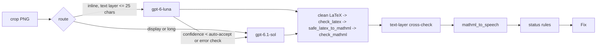

# Equation and figure steps

How the two model-backed steps turn a crop into a fix, and the deterministic checks that
decide whether a fix is trusted. Code: `src/a11y_stem/pipeline/{equation_step,
figure_step, validate, speech}.py`; prompts: `src/a11y_stem/models/prompts/{equation,
figure}.md`; tests: `tests/test_steps_*.py`.

The steps assist a reviewer. They never treat model output as correct on its own: every
proposal passes through validators, carries a confidence and the checks it passed, and
anything that could change what a student reads goes to the review screen as a decision
(`Fix.review == "required"`). Differences that do not change the meaning are accepted with
an optional note (`"optional"`; docs/design/beta-architecture.md "Review tiers").

## At a glance

The first call for an element goes through `models.router.call_with_fallback`: if the
model fails (timeout, API error, refusal, invalid output), the other model is tried once.
The escalation (cheap -> main) is a single main-model call with no fallback, because the
main model's fallback is the cheap model, which has already answered this exact request.
Every attempt becomes a `ModelCall` on the fix. `BudgetExceeded` is never caught here;
the orchestrator (`pipeline.run`) decides what happens to the rest of the document.

## Prompts

Both prompts are constant instruction files, versioned by the loader as
`<name>-<sha8>` (`load_prompt(name).version`). The version goes on every
`VisionRequest` and every `ModelCall`, and is exported as `equation_step.PROMPT_VERSION`
and `figure_step.PROMPT_VERSION` for `DocumentResult.prompt_versions`. Editing a prompt
changes its version, which re-keys the eval baseline.

Document text never goes into the instructions. It travels only in
`VisionRequest.context_text`, which the client fences as untrusted data. Both prompts
tell the model that text between `<document_text>` tags is data, not instructions.

| Prompt | Output schema (strict pydantic, `extra=forbid`) | What it asks for |
|---|---|---|
| `equation.md` | `EquationOutput {is_equation: bool, latex: str, confidence: 0..1}` | Math-mode LaTeX only (no `$`, no `\displaystyle`); transcribe symbol by symbol, never simplify; `\mathbf` for bold vectors, `\vec` for arrows, `\text{}` for words and units, with `<`, `>` and `&` kept outside it; `\%` for a percent sign (a bare `%` is a comment); multi-line equations as `\begin{array}{rcl}` (relation in its own column, matching OpenStax), never `aligned`/`align`/`split`; standard commands only; calibrated confidence bands; a best partial reading with low confidence when unreadable. |
| `figure.md` | `FigureOutput {figure_type: FigureType, decorative: bool, alt: str, confidence: 0..1}` | Classify the figure; decorative only when it adds no information (charts, diagrams, tables and captioned figures never are); alt of at most 150 characters that gives a student the figure's information (charts: type, variables, main trend; diagrams: what it shows and the key relationship); no "Image of ..."; no file names, URLs, markup or LaTeX; do not repeat the caption; abstain (confidence below 0.3, empty alt) when unreadable. |

Why `array{rcl}`: latex2mathml 3.81.1 renders `aligned` as one flat row with literal `&`
tokens, and OpenStax writes multi-line equations as a three-column `mtable`
(`docs/development.md`). The converter also rewrites alignment environments as a safety
net (see `safe_latex_to_mathml` below).

Why the equation's own PDF text layer is not sent to the model: it is the input of the
cross-check. If the model saw it, it could copy it, and the check would stop catching
hallucinations.

## Routing and escalation

| Step | First model | Escalates to `main_model` when |
|---|---|---|
| Equation | `cheap_model` if `display == "inline"` and the text layer is at most 25 characters (or absent); otherwise `main_model` | the cheap answer's confidence (after the cross-check) is below `auto_accept_confidence`, or it fails an error-level check |
| Figure | `cheap_model` with `image_detail="low"` if the figure is tiny (no side longer than 72 pt, one inch on the page); otherwise `main_model` with `image_detail="high"` | confidence is below the accept bar (higher for decorative, see below), the alt text fails an error-level check, or a decorative answer contradicts itself (`decorative_conflict`) |

No escalation happens when the cheap call produced no output at all (the router already
tried the main model as its fallback), or when the answer already came from the main
model as a fallback. The escalation itself is one call to the main model and never falls
back: during a main-model outage that saves a duplicate cheap call (and a slot in
`max_model_calls_per_job`) per escalated element, and the cheap answer stands. After escalation the main model's answer is used, unless it is
unusable and the cheap answer is usable (for example the main model returned invalid
LaTeX); then the cheap answer is kept. The fix's `checks` belong to the answer that was
kept; its `calls` include every attempt.

## Status rules

Thresholds come from settings: `auto_accept_confidence` (default 0.85) and
`abstain_confidence` (default 0.4). A fix is only ACCEPTED when no check failed other
than a note (`NOTE_CODES` of each step); it then has `review="optional"` if a note
failed, else `"none"`. Every other status has `review="required"`.

### Equations (first matching rule wins)

| # | Condition | Status | `reason` |
|---|---|---|---|
| 1 | No parsed output from any attempt | FAILED | `model_<outcome>` (`model_api_error`, `model_timeout`, `model_refused`, `model_invalid_output`, ...) |
| 2 | `is_equation` is false | ABSTAINED | `not_equation` |
| 3 | Empty LaTeX and confidence < abstain threshold | ABSTAINED | `low_confidence` |
| 4 | LaTeX fails an error-level check or does not convert (after escalation) | FAILED | `invalid_latex` |
| 5 | Confidence < `abstain_confidence` | ABSTAINED | `low_confidence` |
| 6 | Confidence >= `auto_accept_confidence` and no failed check other than a note: `style_cosmetic`, `speech_failed`, `speech_empty` | ACCEPTED (review `optional` with notes, else `none`) | |
| 7 | Otherwise | NEEDS_REVIEW | |

Rule 3 exists because the prompt asks the model to abstain with low confidence when it
cannot read the image; an empty answer in that case is an abstention, not invalid LaTeX.

Only ACCEPTED and NEEDS_REVIEW carry a proposal: `EquationFix(latex, mathml, speech,
display)`, with `display` from `Element.display` (default `block`). ABSTAINED and FAILED
fixes have `equation=None`; the original crop stays in the output, flagged.

### Figures (first matching rule wins)

| # | Condition | Status | `reason` |
|---|---|---|---|
| 1 | No parsed output | FAILED | `model_<outcome>` |
| 2 | Confidence < `abstain_confidence` | ABSTAINED | `low_confidence` |
| 3 | Not decorative and the alt text fails an error-level check | FAILED | `invalid_alt` |
| 4 | Confidence >= the accept bar and no failed check other than a warning note: `too_long` (150-300 characters), `redundant_prefix` | ACCEPTED (review `optional` with notes, else `none`) | |
| 5 | Otherwise | NEEDS_REVIEW | |

A caption copy (`caption_copy`) is not a note: it describes nothing the reader does not
already hear, so the figure has no usable description and needs a decision.

The accept bar is `auto_accept_confidence`, raised to 0.95 (`DECORATIVE_ACCEPT_CONFIDENCE`)
for decorative figures: marking a figure decorative hides it from screen-reader users
entirely, so it needs more certainty. Decorative figures always get
`FigureFix(alt="", decorative=True)`, whatever alt text the model wrote.

A decorative answer is also cross-checked against itself and the page. If the model's
`figure_type` is `chart`, `diagram` or `table_image`, the figure has a caption, or the
model wrote alt text anyway, the warning check `figure.decorative_consistency` fails
with code `decorative_conflict`. The fix then goes to review whatever the confidence,
and a tiny figure escalates to the main model first.

The model sees `Caption: ...` (from `Element.caption`) and `Nearby text: ...` (the
`context_text` argument) as context.

## Text-layer cross-check (equations)

When the PDF has a text layer for the equation (`Element.text`) with at least 3 letters
or digits, the step compares two bags of symbols: letters, digits and Greek letters from
the text layer, and the same from the converted MathML's tokens. Both sides are NFKC
normalised (math-italic glyphs such as U+1D463 become `v`) and case-folded; order and
spacing are ignored, so a fraction extracted as "distance time" still matches.

The score is the Dice similarity of the two bags. Below 0.5 is a strong mismatch: the
fix gets a failed warning check (`equation.text_layer`, code `text_layer_mismatch`) and
its confidence is scaled by `0.5 + 0.5 * similarity`. On the cheap model that usually
triggers escalation. Example: text layer "F = ma", transcription `E = mc^2` gives
similarity 0.29, so a 0.95 confidence drops to 0.61.

## Letter-style check (equations)

The text layer also says how letters are styled: layout writes a bold letter as a
Unicode maths bold one (`𝐝`), and Chromium and Word print maths letters as styled code
points (italic `𝑣`, bold `𝐯`). `text_layer_style(text_layer, mathml, regular_letters=...)`
compares the styles of the letters both sides contain, occurrence by occurrence, and
returns `None` (the text layer says nothing about style), `"match"`, `"meaning"` or
`"cosmetic"`:

- **Meaning-level** (check `equation.text_layer_style`, code `style_mismatch`; confidence
  scaled by 0.6, so a cheap answer escalates, and the fix needs a decision): a variable (a
  one-letter token outside sub/superscripts and limits) whose weight changed:
  - a letter that is bold in the PDF read as a plain variable: a vector read as a scalar
    (`𝛚` -> `\omega`; `𝐝 = 𝐝0` -> `\mathbf{d} = d_0`). Plain occurrences in the PDF
    are matched to scripts and words first, so when in doubt it asks;
  - a letter known to be plain made a bold variable: a scalar read as a vector. Known
    plain = a math italic code point, or a letter layout found, not bold, in a regular
    font with a bold face (`Element.regular_letters`: Computer Modern CMR/CMMI, Times,
    DejaVu, STIX, ...; docs/layout.md).
- **Cosmetic** (code `style_cosmetic`; an optional note, no confidence change, no
  escalation): every other difference: a bold subscript, superscript or word (`𝐝𝐟` ->
  `\mathbf{d}_{\text{f}}`, a bold "avg"), a bold digit (`𝐝𝟎` -> `\mathbf{d}_0`), a style
  the text layer cannot show (MSBM's double-struck R is a plain `R` there, so
  `\mathbb{R}` differs), and a plain letter of unknown weight made bold (a font that
  does not mark bold says nothing).

Measured cases (2026-10-08): OpenStax 2.1's `d_0` and `d_f` with bold subscripts and the
LaTeX handout's `\mathbb{R}^n` are cosmetic; the handout's bold omega read as `\omega` is
meaning-level. `tests/test_style_check.py` pins each.

## Validators and codes

All validators return one `Check` per rule, passed or failed, so the review screen can
show what a fix passed. Failures carry a category code and never the offending text.
Error-level failures block ACCEPTED (and make LaTeX or alt text unusable); warnings only
send the fix to review.

### `check_latex(latex)`

| Check name | Code | Severity | Fails when |
|---|---|---|---|
| `latex.not_empty` | `empty` | error | blank input (returned alone) |
| `latex.length` | `too_long` | error | more than 2000 characters |
| `latex.balanced_braces` | `unbalanced_braces` | error | unescaped `{`/`}` do not balance |
| `latex.balanced_environments` | `unbalanced_env` | error | `\begin`/`\end` missing, mismatched or nameless |
| `latex.no_math_delimiters` | `math_delimiter` | error | an unescaped `$` remains after cleanup |
| `latex.no_comments` | `comment` | error | an unescaped `%`: latex2mathml (like TeX) drops the rest of the line, so `x = 50% + y` would become `x = 50` |
| `latex.no_forbidden_commands` | `forbidden_command` | error | file, shell, macro or link commands: `\input \include \write \immediate \openout \read \def \gdef \edef \xdef \let \newcommand \renewcommand \providecommand \newenvironment \DeclareMathOperator \catcode \csname \expandafter \href \url \usepackage \documentclass \special \includegraphics \verb \class \style \htmlClass ...` |
| `latex.allowed_commands` | `unknown_command` | error | any control word or symbol not in the allowlist |
| `latex.allowed_environments` | `unknown_environment` | error | an environment other than `array matrix pmatrix bmatrix Bmatrix vmatrix Vmatrix cases aligned align align* gathered split` |
| `latex.command_arguments` | `bad_argument` | error | `\hspace` without a braced, non-negative dimension (`x \hspace y` would become `<mspace width="y">` and lose the `y`) |
| `latex.plain_text_arguments` | `markup_in_text` | error | `<`, `>` or `&` in the argument of `\text \textrm \textbf \textit \textsf \texttt \textnormal \textup \mbox` (latex2mathml copies that argument into its XML unescaped, so it would become markup) |

The allowlist (`validate.ALLOWED_COMMANDS`) covers Greek letters, binary operators,
relations, arrows, common symbols, large operators, function names, spacing, sizing and
delimiters, accents (`\vec \hat \bar \dot \ddot \tilde \overline \underline
\overrightarrow ...`), fonts (`\mathbf \mathrm \mathit \mathcal \mathbb \boldsymbol \text
\textrm \textbf \operatorname ...`) and structures (`\frac \dfrac \tfrac \sqrt \binom
...`). A test converts every allowed command with latex2mathml and fails if any of them
comes through unconverted, so the allowlist cannot drift from what the converter
supports. `\not` and `\arg` are left out for that reason.

Before checking, the equation step removes wrappers the prompt forbids but models still
add: `$...$`, `$$...$$`, `\[...\]`, `\(...\)`, `equation` environments, `\displaystyle`,
and a trailing `\\` (`equation_step.clean_latex`). It also escapes every bare `%` as
`\%` (`validate.escape_percent_signs`): in one transcribed equation a `%` is a percent
sign, never a comment. None of this changes the mathematics. Other callers of
`check_latex` (for example a reviewer's LaTeX edit) get `comment` for a bare `%`.

### `safe_latex_to_mathml(latex, display)`

1. Refuses input over 2000 characters.
2. Rewrites `aligned`, `align`, `align*`, `split` and `gathered` to
   `\begin{array}{...}`: right/left alternating columns (`rl`, `rlrl`, ...) sized to the
   widest row's top-level `&` count (ampersands inside nested matrices or braces are not
   counted); `gathered` becomes centred columns. Optional `[t]` positions are dropped.
3. XML-escapes `<`, `>` and `&` in the spans latex2mathml copies verbatim (text-command
   arguments and `\verb`, located with latex2mathml's own tokenizer pattern). Its
   serialiser unescapes `&lt;`, `&gt;` and `&amp;` across the whole output, so without
   this `\text{</mtext><mphantom>...}` would become real elements.
4. Converts with latex2mathml.
5. Parses the result with defusedxml, sets `display`, and unescapes `\%`, `\_`, `\#`,
   `\$` in `<mtext>` (latex2mathml leaves the backslash in text mode).
6. Re-serialises with `serialize_mathml`, which writes one MathML `xmlns` on the root and
   refuses (`UnsafeMathMLError`, message = the code) any tree that fails the allowlist
   rules of `check_mathml`: an unknown element or attribute, markup inside a token, a
   nested `<math>`, or nesting deeper than 200.

The output is therefore safe to insert into HTML even for a caller that skips
`check_latex` and `check_mathml`. Any failure raises `LatexConversionError` with a
content-free message (the converter's own message, which quotes the input, is dropped).
Inputs so deeply nested that the converter recurses too far fail the same way.

### `check_mathml(mathml)`

| Check name | Code | Fails when |
|---|---|---|
| `mathml.size` | `too_large` | more than 100,000 characters or 5,000 elements |
| `mathml.well_formed` | `not_well_formed` / `forbidden_xml` | not XML; or a DTD, entity declaration or external reference (defusedxml refuses them, so entity expansion attacks never run) |
| `mathml.root` | `wrong_root` / `missing_namespace` / `nested_math` | the root is not `<math>` in the MathML namespace, or a `<math>` appears below the root |
| `mathml.known_elements` | `unknown_element` | an element outside MathML Core plus common presentation elements (no `maction`, no `mglyph`, nothing from another namespace) |
| `mathml.safe_attributes` | `unsafe_attribute` / `unknown_attribute` | `href`, `src`, `style`, `class`, `id`, `on*`, any namespaced attribute, or a value containing `javascript:`, `data:`, `url(` or `<`/`>` (unsafe); any other attribute outside the layout allowlist, such as `mathcolor`, or the MathML 4 speech overrides `intent` and `arg` (unknown); `alttext` is allowed on the root only |
| `mathml.token_content` | `markup_in_token` | an element inside `mi`, `mn`, `mo`, `mtext` or `ms` (other than `malignmark`); browsers parse children of `<mtext>` as HTML |
| `mathml.depth` | `too_deep` | nesting deeper than 64 (measured without recursion) |
| `mathml.structure` | `bad_arity` | `mfrac`, `mroot`, `msub`, `msup`, `munder`, `mover` without 2 children, or `msubsup`, `munderover` without 3 (latex2mathml turns `\frac{a}` into a one-child `mfrac`) |
| `mathml.converted` | `unconverted_command` | LaTeX left in a token (`<mi>\foo</mi>`, `<mtext>\textbf{x</mtext>`, `<mtext>a\,b</mtext>`: a backslash followed by a command name or any non-alphanumeric character), any `merror`, or a stray alignment `&` in an `mi` |

All are error-level. All 30 gold MathML equations pass.

### `check_alt(alt, *, decorative, caption)`

| Check name | Code | Severity | Fails when |
|---|---|---|---|
| `alt.decorative` | `decorative_with_text` | error | decorative but the alt is not empty (returned alone) |
| `alt.not_empty` | `empty` | error | informative figure with blank alt, or alt made only of invisible characters such as U+200B (returned alone) |
| `alt.length` | `too_long` | warning over 150 characters, error over 300 | |
| `alt.no_redundant_prefix` | `redundant_prefix` | warning | starts with "image of", "picture of", "graphic of", "photo of" or "photograph of" (optionally after "a", "an" or "the") |
| `alt.not_filename` | `filename` | error | contains a file name with an image or document extension, or is a single camera or export name (`IMG_2041`, `DSC0042`, `figure_3_2`) |
| `alt.no_url_or_markup` | `url_or_markup` | error | a URL, `www.`, a `javascript:` or `vbscript:` URL, a data URI, HTML tags or entities, a Markdown link, or a LaTeX command |
| `alt.not_placeholder` | `placeholder` | error | fewer than two letters or digits ("." or an emoji), only words that say nothing about the content ("Image", "An image", "Unreadable image", "No alt text", "N/A", "Not available", "Screenshot"; `validate.PLACEHOLDER_WORDS`), or a bare label ("Figure 2.3") |
| `alt.not_caption_copy` | `caption_copy` | warning | equal to the caption ignoring case, punctuation and a leading "Figure N.N" label |

All alt rules judge the visible text: format characters (Unicode category Cf, such as
U+200B and U+2063) and filler characters are removed first, so they cannot hide a file
name, URL or placeholder.

OpenStax's own alt text in the gold set triggers only `too_long` and `redundant_prefix`
(it is written for a different, longer format), never an error-level content rule.

## Speech (`mathml_to_speech`)

Deterministic English for the review screen and report; the output HTML keeps MathML
only. Input is parsed with defusedxml (depth-capped) and normalised with the scorer's
`eval.equations.normalize`, so OpenStax markup and latex2mathml markup read the same.

| Construct | Reading |
|---|---|
| Simple fraction (each side one or two plain tokens) | "a over b", "capital delta bold d over capital delta t" |
| Other fractions | "the fraction ... over ... end fraction" |
| `linethickness=0` fraction | "n choose k" |
| Powers | "x squared", "x cubed", "x to the power n", "10 to the power minus 3", "e to the power minus k t end power" |
| Primes, degrees | "y double prime", "30 degrees" |
| Subscripts | "x sub 0", "v sub avg", "x sub i plus 1 end sub" |
| Roots | "the square root of x", "... end root" when compound, "the cube root of", "the root of index n of" |
| Large operators | "the sum from i equals 1 to n of", "the integral from 0 to 1 of", "the product over k of" |
| Limits | "the limit as x approaches 0 of" (an arrow under `lim` reads "approaches") |
| Operators and relations | equals, minus, plus or minus, times, divided by, less than or equal to, approximately equals, proportional to, right arrow, ... |
| Letters | "x", "capital F"; Greek "delta", "capital delta"; bold "bold d"; double-struck "double-struck capital R" |
| Accents | "vector d" (arrow over), "x hat", "x bar", "x dot", "x tilde" |
| Functions | "sine", "cosine", "natural log", ... |
| Tables | "row 1: ...; row 2: ..." when there are several rows; cells of an aligned equation read as one line, matrix cells are comma-separated |
| Text | verbatim, except words that are a single maths symbol ("time =" reads "time equals") |
| Unknown symbols | their Unicode name, lower-cased |

Sentence punctuation at the very end of the equation is not read. Unreadable input
raises `SpeechError` with a content-free message. In the equation step a speech failure
is a warning (`speech.generated`, code `speech_failed`), not an error, and only an optional
note: the output keeps MathML only, so a missing reading aid changes nothing a student gets.

## Privacy

`Check.code`, `Fix.reason` and `ModelCall.outcome` are category codes. Exception
messages from the validators never contain LaTeX, MathML or alt text. Tests assert that
document text does not leak into checks, reasons or call records, that context text
never reaches the instructions, and that the equation's text layer is never sent.

## Tests

| File | What it covers |
|---|---|
| `tests/test_steps_validate.py` | every code of every validator; the allowlist-vs-converter tests (no allowed command converts with leftovers, every command whose argument is copied verbatim is treated as text mode); alignment rewriting; `\text{}` injection and a fuzz test showing `safe_latex_to_mathml` output is always allowlisted; defusedxml refusing DTDs and entity bombs; deep and oversize input; gold MathML and OpenStax alt text as real-data sanity checks |
| `tests/test_steps_speech.py` | all 30 gold equations produce speech; targeted rules |
| `tests/test_steps_equation.py` | every status path, routing, escalation, fallback, the cross-check, strict schema, budget propagation, prompt version and context hygiene |
| `tests/test_steps_figure.py` | the same for figures, plus decorative handling and tiny-figure routing |
| `tests/test_steps_live.py` | `live_model`: a gold equation rendered from MathML in Chromium and a generated bar chart, through the real API |
| `tests/test_steps_support.py` | helpers, including `fallback_router`, a stand-in for WP1's router used until it merges |

Offline: `uv run pytest`. Live (costs about $0.01): `uv run --env-file .env pytest -m
live_model tests/test_steps_live.py -s`.

Live run on 2026-10-07: the three-row OpenStax equation (`2-2-speed-and-velocity/eq-005`)
came back as `\begin{array}{rcl}` LaTeX, ACCEPTED at 0.99 confidence on `gpt-6.1-sol`
($0.0037); the bar chart got "Bar chart with trips on the horizontal axis and speed in
km/h vertically: Trip A averages 40, Trip B 90, and Trip C 150 km/h." (ACCEPTED, 0.99,
$0.0033). That run used the prompts as they were before the `\%`, `\text{}` and
decorative rules were added; the prompt versions have changed since.

## Known limits

- The cross-check needs a text layer; scanned PDFs get no cross-check.
- Speech is a reviewer aid, not a screen reader: it does not do function application
  ("f open parenthesis x close parenthesis"), and it reads `\cdot` as "times".
- The command allowlist is curated; a legitimate command outside it (for example
  `\hslash` or `\varGamma`) fails as `unknown_command` and the fix goes to FAILED
  `invalid_latex` after escalation. Extend the lists in `validate.py`; the conversion
  test then checks the new entries.
- `<`, `>` and `&` inside `\text{}` are refused (`markup_in_text`) even where they are
  valid LaTeX, such as `\text{R\&D}` or `\text{if x < 5}`; the prompt asks for
  `\text{if } x < 5`. The converter would render them safely as text, but in model
  output they are far more likely to be an injection or a confused transcription.
- Confidence is the model's own estimate (scaled by the cross-check). Calibration against
  the gold set is WP7's job.
